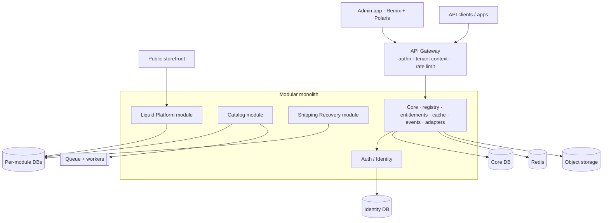

# Platform Architecture & Workflow — Core Module + Authentication (v1)

> **Purpose of this document.** This is the reference spec for the **shared platform kernel** (Core module) and the **Authentication/Identity module**. Every future product module (Catalog Automation, Shipping Recovery, Liquid Platform) is built on top of these two, following the same conventions. It is written to be consumed by **AI coding agents** — the structure, contracts, and conventions here are deliberately rigid so an agent can build module N without re-deciding foundational patterns.

---

## 0. Design principles (non-negotiable)

These make the codebase clean, AI-agent-buildable, and scale-ready with no rework.

1. **Modular monolith first, service-extractable later.** One deployable app, hard module boundaries. Split a module into its own service only when metrics demand it — the boundaries already exist, so extraction is mechanical.
2. **Stateless app tier.** No session or request state in process memory. All state lives in Postgres (durable) or Redis (ephemeral/hot). This is the single most important rule for horizontal scale — any node can serve any request.
3. **Contracts first.** A module never imports another module's internals — only its published `contracts/` (typed interfaces + events). This is what lets an agent work on one module without breaking others.
4. **Convention over configuration.** Every module has the *same* folder skeleton, the same `MODULE_CONTRACT`, the same naming. An agent building module #4 fills a template; it does not invent structure.
5. **Multi-tenant by default.** `tenant_id` on every tenant-owned row, enforced by Postgres Row-Level Security (RLS). Tenant context is resolved once per request and propagated — never passed ad hoc.
6. **Entitlement-gated.** Every feature checks the tenant's active modules/plan before running. Enable/disable is a single toggle backed by entitlements.
7. **Event-driven extensibility.** Modules communicate and are extended through a typed event bus + hook points — never by reaching into each other. (This is the plugin mechanism, adopted from day one.)
8. **Adapters for all external infra.** Storage, email, cache, queue, search, and the auth provider all sit behind an interface. Swapping S3 for another store = new adapter, zero call-site changes.
9. **Observability is not optional.** Structured logs, traces, metrics, and per-tenant usage metering are built into the request lifecycle from commit #1. You cannot optimize for 100M what you cannot measure.

---

## 1. Scale philosophy — "design for 100M, build for 100K, pull levers on demand"

Building 100M-user infrastructure (global sharding, multi-region active-active) before you have users is the classic over-engineering death. But an architecture that *can't* reach 100M forces a rewrite later. The resolution:

- **Architecture is 100M-ready by construction:** stateless tier, cache-first reads, async for anything heavy, tenant-shardable data model, no cross-tenant joins.
- **Implementation is right-sized for the first 100K–1M users:** single Postgres primary + one read replica, single Redis cluster, one region.
- **Scale levers are pre-identified** (Section 7) so growth is a config/ops change, not a redesign.

Reality check: 100M *rows* in Postgres is routine; 100M *concurrent* requests is not. The cost is in hot paths, concurrency, and data volume — all solved by caching + replicas + async + partitioning, with sharding and multi-region as documented later levers.

---

## 2. Tech stack (recommended)

| Layer | Choice | Why |
|---|---|---|
| Backend | **TypeScript + NestJS** | Its module + provider + dependency-injection model *is* your module/plugin architecture. One language front-to-back. (.NET is a valid alternative given your experience; pick one and standardize.) |
| Monorepo | **Nx** | First-class support for many apps + shared packages; fits modular multi-product. |
| Frontend | **Next.js + React + TS**, shared UI package | One design system, product-appropriate flows. |
| Primary DB | **PostgreSQL** | RLS for tenancy, JSONB for flexible attributes, partitioning, mature replication. |
| ORM | **Drizzle** or **Prisma** | Typed schema, migrations. |
| Cache / ephemeral | **Redis (clustered)** | Sessions, cache, rate limits, hot lookups, queues. |
| Queue / async | **BullMQ** (Redis) → SQS/Kafka at scale | Offload heavy work; workers scale independently. |
| Auth primitives | **SuperTokens / Ory (self-host)** behind an adapter; **Clerk/WorkOS** to start fast | See §4 note on 100M cost. |
| Billing | **Stripe Billing** | Subscriptions → entitlements. Never build billing. |
| Object storage | **S3** behind `StorageProvider` adapter | Swappable per your requirement. |
| Observability | **OpenTelemetry** + Prometheus/Grafana + Loki | Traces, metrics, logs. |
| Deploy | Docker → Fly/Render/ECS (not k8s early) | Right-sized ops. |

---

## 3. Repository & module structure (the AI-agent skeleton)

```
apps/
  api/                     # NestJS backend (the modular monolith)
  web/                     # Next.js frontend
packages/
  ui/                      # shared design system (Shopify-style shell)
  contracts/               # cross-module TS types & event definitions
  config/                  # shared config schema
apps/api/src/
  core/                    # THE CORE MODULE (§5)
    tenant-context/
    module-registry/
    entitlements/
    event-bus/
    cache/
    rate-limit/
    adapters/              # storage, email, queue, search interfaces + impls
    observability/
    http/                  # gateway conventions: guards, interceptors, response envelope
  auth/                    # THE AUTH MODULE (§6)
  modules/                 # PRODUCT MODULES, all identical shape:
    catalog/
    shipping-recovery/
    liquid-platform/
```

**Every product module follows this exact skeleton** (copy-paste for module N):

```
modules/<name>/
  <name>.module.ts     # registration + MODULE_CONTRACT
  domain/              # entities, value objects, pure business rules (no I/O)
  application/         # use-cases / services (orchestration)
  infrastructure/      # repositories, adapter implementations
  api/                 # controllers, DTOs, request validation, versioned (/v1)
  events/              # typed events this module emits + consumes
  contracts/           # the ONLY thing other modules may import
  config/              # module config schema + defaults
  tests/
  README.md            # AI-agent-facing: what it does, its contracts, its events
```

**Every module declares a `MODULE_CONTRACT`** (this is its registry entry — the heart of "no rework"):

```ts
export const CATALOG_CONTRACT: ModuleContract = {
  name: 'catalog',
  version: '1.0.0',
  entitlementKey: 'catalog',          // gates enable/disable + billing
  dependsOn: ['core', 'auth'],
  permissions: ['catalog.read', 'catalog.write', 'catalog.import'],
  routes: [{ prefix: '/v1/catalog' }],
  events: {
    emits:   ['catalog.product.created', 'catalog.import.completed'],
    consumes:['auth.tenant.created'],
  },
  hooks: ['catalog.beforeProductSave', 'catalog.afterImport'], // extension points
};
```

An AI agent building a new module: scaffold the skeleton, fill the contract, implement domain → application → api, register events/hooks. Nothing about tenancy, auth, caching, or limits is re-decided — it's inherited from Core.

---

## 4. Authentication / Identity module

### 4.1 Buy the primitives, own the model
Do **not** hand-roll password hashing, OAuth, MFA, or session crypto — it's a security minefield. Use a proven engine behind an adapter. **Honest 100M cost note:** managed auth (Clerk/WorkOS) is priced per monthly-active-user and becomes extremely expensive at tens of millions of MAU. So: `AuthProvider` is an **adapter** — start on managed for speed, migrate to **self-hosted SuperTokens/Ory** when MAU economics demand it, with zero change to your identity model. You own the tenant/org/role/entitlement model on top; the provider only handles credentials, sessions, MFA, SSO.

### 4.2 Identity data model

```
User                # global identity
  id, email(unique), status, mfa_enabled, provider_ref, created_at

Tenant              # the "store"/account boundary — owns all data & billing
  id, slug(unique), name, type[store|partner_managed], status, created_at

Membership          # User ↔ Tenant (enables collaboration & multi-store)
  id, user_id, tenant_id, role_id, invited_by, status

Role                # RBAC, module-scoped permissions
  id, tenant_id(nullable=system), name, permissions[]   # e.g. ['catalog.write']

PartnerAccount      # Shopify-partner analog: manages many client tenants
  id, owner_user_id, name

PartnerTenant       # PartnerAccount ↔ managed Tenant
  partner_id, tenant_id, access_level

Session / RefreshToken   # opaque refresh token, stored in Redis (+ audit row in PG)
  id, user_id, tenant_id, device, expires_at, revoked

ApiKey              # programmatic access, per tenant, scoped
  id, tenant_id, hashed_key, scopes[], last_used_at

Invitation          # collaborator onboarding
  id, tenant_id, email, role_id, token, expires_at

AuditLog            # security events (login, role change, key use)
  id, tenant_id, actor_user_id, action, meta, created_at
```

### 4.3 Account types (mapping your requirements)
- **Store-only account** → a `Tenant(type=store)` + an owner `Membership`.
- **Partner account** → a `PartnerAccount` linked via `PartnerTenant` to many client tenants; gets the **Partner Dashboard**.
- **Collaborator** → a `Membership` in a tenant the user doesn't own, with a limited `Role`.
- One `User` can belong to many tenants (multi-store), and a tenant can have many users (collaboration). This single model covers all four cases.

### 4.4 Token strategy (the key to 100M)
Auth verification must **not** hit the database on every request.

- **Access token = short-lived JWT (5–15 min)**, signed with a rotating key pair. Carries `user_id`, `tenant_id`, `roles`, `entitlements_hash`. Verified statelessly at the gateway via public key — **zero DB call** on the hot path.
- **Refresh token = opaque, in Redis** (+ durable audit row). Used only on refresh, which is rare.
- **Revocation** = a Redis denylist keyed by token/session id, checked cheaply; JWTs are short-lived so the blast radius of a stale token is minutes.

### 4.5 Core auth flows

```
SIGNUP (store)
  → AuthProvider.createCredential(email, pw)
  → create User + Tenant(type=store) + Membership(owner)
  → emit auth.tenant.created   (Core seeds defaults; modules react)
  → issue access(JWT)+refresh(Redis)

LOGIN
  → AuthProvider.verify(email, pw[, mfa])
  → resolve default/selected tenant + roles + entitlements
  → issue access(JWT: user,tenant,roles,entitlements_hash)+refresh
  → audit

REQUEST (hot path — see §5.6)
  → gateway verifies JWT (stateless) → denylist check (Redis) → tenant context

REFRESH
  → validate refresh (Redis) → rotate → new access+refresh

PARTNER CREATES STORE
  → Partner (authorized) → create Tenant(type=partner_managed) + PartnerTenant link
  → emit auth.tenant.created

COLLABORATOR INVITE → ACCEPT
  → create Invitation(token) → email → accept → create Membership(role) → audit
```

### 4.6 Auth scale & security
- Rate-limit auth endpoints hard (credential stuffing): per-IP + per-account token buckets in Redis; exponential backoff; CAPTCHA on anomaly.
- `User`/`Tenant` in Postgres handle 100M rows fine with proper indexes; hot lookups (tenant config, permissions) cached in Redis with event-based invalidation.
- Later lever: shard identity by `tenant_id` (rarely needed before hundreds of millions).

---

## 5. Core / Platform module

The kernel every module depends on. Sub-components:

### 5.1 Tenant Context
Request-scoped object `{ tenant, user, roles, entitlements }`, resolved once per request (from JWT + subdomain/path) and injected everywhere. Nothing queries "who is this tenant" twice.

### 5.2 Module Registry
Modules self-register their `MODULE_CONTRACT` at boot. Central table `TenantModule(tenant_id, module, enabled, config)` drives the **single enable/disable toggle**. Registry answers "is module X enabled for tenant Y" (cached). This keeps dashboards uncluttered — disabled modules render nothing and cost nothing.

### 5.3 Entitlements
Maps `tenant → active modules + plan limits`, synced from **Stripe** webhooks. Cached in Redis (`entitlements:{tenant}`), invalidated on subscription change. Every feature calls `entitlements.assert(tenant, 'catalog.import')`. The `entitlements_hash` embedded in the JWT lets the gateway short-circuit most checks without a lookup.

### 5.4 Event Bus / Hooks
Typed pub/sub. Two kinds:
- **Events** (`emit`) — fire-and-forget facts (`catalog.product.created`). In-process (Nest CQRS/EventEmitter) now → **Redis Streams/Kafka** when modules become services.
- **Hooks** (`filter/action`) — synchronous extension points that can transform data (`beforeProductSave`). This is the WordPress-style extensibility, but **typed and out-of-core for third parties** (they subscribe via registered handlers / webhooks, never by editing core).

### 5.5 Central infra services
- **Cache** — one abstraction over Redis with **tag-based invalidation** conventions every module reuses (`cache.wrap(key, ttl, tags, fn)`).
- **Rate limit / quotas** — central token-bucket in Redis, **per-tenant + per-plan**, applied as a gateway guard. Also enforces your public **API limits** by plan tier.
- **Adapters** — `StorageProvider`, `EmailProvider`, `QueueProvider`, `SearchProvider`, `AuthProvider` — interface + implementation, chosen by config.
- **Observability** — request tracing, structured logs with `tenant_id`, metrics, and a **usage-metering** stream (events → aggregation) that feeds both billing and limit enforcement.

### 5.6 Request lifecycle (the hot path — every request)
```
Client
  → API Gateway
     1. verify JWT (stateless, public key)          # no DB
     2. denylist check (Redis)                       # cheap
     3. resolve Tenant Context                        # cached
     4. entitlement gate (hash in JWT / Redis)        # cheap
     5. rate-limit / quota (Redis token bucket)       # cheap
  → Controller (api/) → validate DTO
  → Use-case (application/)
     → cache.wrap(...) reads                          # Redis first
     → repository (infrastructure/) → Postgres (RLS)  # only on miss
     → emit events (async)                            # queue
  → Response envelope { data, meta, errors }          # consistent shape
```
Steps 1–5 are all cache/crypto, **no primary-DB hit** — that's what makes the hot path survive scale.

---

## 6. Caching, limits & optimization (central, by design)

| Concern | Mechanism | Invalidation |
|---|---|---|
| Session validation | Stateless JWT + Redis denylist | short TTL (minutes) |
| Tenant config / entitlements | Redis, `tenant:{id}` | event-based on change |
| Permission checks | roles in JWT + Redis fallback | on role change |
| Hot reads (catalog, etc.) | `cache.wrap` + tags | tag bust on write |
| Static / theme / public API | CDN + edge cache | versioned keys |
| Heavy work (imports, claim runs) | BullMQ queue + workers | n/a (async) |
| Per-tenant API limits | Redis token bucket, plan-tiered | plan change |
| DB read scaling | read replicas + PgBouncer pooling | n/a |
| Large tables | partition by tenant/time | n/a |

All of it flows through **Core** — no module implements its own caching or limits; it calls the central services. That's the "central and easily manageable" requirement satisfied structurally.

---

## 7. Scale-lever roadmap (pull on metrics, not fear)

| Trigger (metric) | Lever |
|---|---|
| Read latency ↑ | Add Postgres read replicas; route reads |
| Redis hot | Redis Cluster sharding; separate cache/queue instances |
| Worker backlog | Scale worker pool; split queues by priority |
| A module dominates load | Extract it to its own service (boundaries already exist) |
| Single PG write ceiling | Shard by `tenant_id`; move cold data to archive |
| Global latency | Multi-region: stateless tier + regional read replicas + geo-routing |
| Auth MAU cost ↑ | Swap `AuthProvider` managed → self-hosted |

None of these require touching module business logic — they're ops/config, because the architecture reserved the seams.

---

## 8. Frontend architecture & URL patterns (Shopify-aligned)

### 8.1 Frontend tech
- **React + TypeScript.**
- **Remix** for the admin app — it's what Shopify itself uses, and its nested file-based routing maps 1:1 to the resource URL pattern below. (Next.js is a fine alternative; Remix is the Shopify-parity choice.)
- **Polaris** (`@shopify/polaris`) — Shopify's own open-source React design system. **This is how you get literally the same screens.** Start with Polaris re-themed with your brand tokens (color, logo, radius) for own-branding; graduate to a custom Polaris-modeled system later if you want full control. Because every screen consumes the shared `packages/ui`, swapping the underlying components never changes the screens.
- **API style:** Shopify's Admin API is **GraphQL** with dated versions. GraphQL matches Shopify and suits a module-driven multi-resource admin; REST is simpler to start. Your call (see decisions).
- **App Bridge is NOT needed** — that's only for apps embedded *inside* Shopify's admin; you're building your own admin, so skip it.

### 8.2 App shell + module-driven UI (mirrors the backend)
The frontend mirrors the backend module system exactly:
- A shared **App Shell** provides the chrome — top bar, left nav, **store switcher**, account menu — i.e. the Shopify-admin layout.
- Each product module ships a **frontend package** that registers its **nav items + routes + screens** into the shell (a frontend module registry mirroring the backend `MODULE_CONTRACT`).
- Enable/disable a module → its nav entries and routes appear or disappear. One toggle, no clutter — your requirement, enforced on the frontend too.

### 8.3 Standard screen templates (identical screens, agent-buildable)
Every module builds its UI from the same four templates (Polaris patterns), so screens are consistent by construction:
- **ListScreen** — `IndexTable` + filters + bulk actions (the Shopify product-list pattern).
- **DetailScreen** — `Page` + `Card` form sections + sticky save bar.
- **CreateScreen** — the same form, empty state.
- **SettingsScreen** — `Page` + setting `Card`s.

```
apps/web/                      # admin shell (Remix)
  app/routes/                  # file-based routes == the URL patterns in 8.4
  app/shell/                   # topbar, nav, store switcher, account menu
  app/module-registry.ts       # modules register nav + routes here
packages/ui/                   # shared design system (Polaris + brand tokens)
  components/                  # Page, Card, IndexTable, Form...
  templates/                   # ListScreen, DetailScreen, CreateScreen, SettingsScreen
  theme/                       # brand tokens (your branding)
```
An agent building a module's UI fills these templates — it never designs a screen from scratch.

### 8.4 Complete URL map (Shopify-aligned)

Four hostnames, mirroring Shopify's separation of concerns:

| Host | Purpose |
|---|---|
| `<app>.com` | Marketing + unauthenticated auth (login/signup/reset) |
| `accounts.<app>.com` | The **user's identity** — spans every store they belong to |
| `admin.<app>.com` | The **authenticated app** — one store at a time, all modules |
| `partners.<app>.com` | The **partner dashboard** — manage many client stores |
| `api.<app>.com` | Versioned API (dated, Shopify-style) |
| *custom / subdomain* | Public **storefronts** (Liquid module output) |

**Key distinction (Shopify does this, and it matters): the _person_ and the _store_ are different accounts.** A user's profile/password/2FA lives on `accounts.` and is shared across all their stores; a store's own settings (owner, plan, staff) live under `/store/{handle}/settings`. Don't merge them.

#### 8.4.1 Unauthenticated / identity — `<app>.com`
```
/                                # marketing / landing
/login                           # sign in
/login/mfa                       # 2FA challenge
/signup                          # create account + first store
/logout
/password/forgot                 # request reset
/password/reset/{token}          # set new password
/verify-email/{token}            # email verification
/invite/{token}                  # accept staff/collaborator invite
/oauth/{provider}                # SSO / social start
/oauth/{provider}/callback       # SSO callback
```

#### 8.4.2 User account (the person — spans all stores) — `accounts.<app>.com`
Mirrors Shopify's `accounts.shopify.com`.
```
/                                # account overview
/profile                         # name, email, avatar, locale, timezone
/security                        # change password
/security/two-step               # 2FA / MFA + recovery codes
/security/passkeys               # WebAuthn / passkeys
/sessions                        # active devices; sign out others
/notifications                   # personal notification preferences
/connected-accounts              # linked SSO / social logins
/stores                          # every store this user can access (picker)
/stores/new                      # create a new store
/close                           # close personal account
```

#### 8.4.3 Store selection / entry — `admin.<app>.com`
```
/                                # 1 store → redirect; many → picker
/store-picker                    # choose a store
/store/new                       # create store (name, handle, region)
```

#### 8.4.4 Store dashboard (per store) — `admin.<app>.com/store/{handle}`
```
/store/{handle}                  # HOME / overview dashboard (KPIs, activity, tasks)
/store/{handle}/search           # global search within the store
/store/{handle}/notifications    # store notification inbox
/store/{handle}/activity         # store audit / activity log
```

#### 8.4.5 Services / Modules (the enable–disable center)
Your single-toggle module management.
```
/store/{handle}/services                     # all modules: enabled + available
/store/{handle}/services/{module}            # module overview + enable/disable
/store/{handle}/services/{module}/subscribe  # subscribe / upgrade a module plan
```

#### 8.4.6 Per-module screens (only visible when the module is enabled)
```
# Catalog Automation
/store/{handle}/products            /store/{handle}/products/new
/store/{handle}/products/{id}       /store/{handle}/products/{id}/variants/{vid}
/store/{handle}/collections         /store/{handle}/collections/{id}
/store/{handle}/catalog/imports     /store/{handle}/catalog/imports/{id}
/store/{handle}/catalog/master-data/brands
/store/{handle}/catalog/master-data/proposals     # crowd-proposed brands/attrs

# Shipping Recovery
/store/{handle}/claims              /store/{handle}/claims/new
/store/{handle}/claims/{id}         /store/{handle}/claims/{id}/evidence
/store/{handle}/shipping-recovery/eligible        # eligible shipments queue
/store/{handle}/shipping-recovery/analytics       # recovered $ dashboard

# Liquid Platform
/store/{handle}/online-store        /store/{handle}/themes
/store/{handle}/themes/{id}/editor  /store/{handle}/pages   /store/{handle}/pages/{id}
/store/{handle}/blogs/{id}/posts/{pid}   /store/{handle}/navigation
```

#### 8.4.7 Store settings — `admin.<app>.com/store/{handle}/settings`
Modeled on Shopify's settings. Core sections always present; per-module sections appear when that module is enabled.
```
# --- Core (always present) ---
/settings                        # settings home (section index)
/settings/general                # store name, handle, timezone, units, contact
/settings/plan                   # current plan; change / cancel
/settings/billing                # payment method, credits
/settings/billing/invoices       /settings/billing/invoices/{id}
/settings/usage                  # metered usage per module (API calls, imports…)
/settings/users                  # staff & collaborators
/settings/users/new              # invite a user
/settings/users/{id}             # member: role, permissions, status
/settings/roles                  /settings/roles/{id}     # RBAC
/settings/notifications          # store notification rules / templates
/settings/domains                /settings/domains/connect   # custom domains, DNS, SSL
/settings/brand                  # logo, colors (own-branding tokens)
/settings/custom-data            # metafields / metaobjects definitions
/settings/languages              /settings/policies          # locales, legal
/settings/account                # store owner, transfer ownership, close store

# --- Developer / API ---
/settings/apps                   /settings/apps/{id}          # installed apps / extensions
/settings/developer              # developer hub
/settings/developer/api-keys     /settings/developer/api-keys/new
/settings/developer/webhooks     /settings/developer/webhooks/new
/settings/developer/events       # webhook / event delivery log

# --- Per-module settings (appear when enabled) ---
/settings/catalog                # margins, variant axes, taxonomy rules
/settings/shipping-recovery      # carriers, InsureShield, filing rules
/settings/online-store           # theme / checkout prefs
```

#### 8.4.8 Partner dashboard — `partners.<app>.com/{partner-id}`
```
/{partner-id}                    # partner overview
/{partner-id}/stores             # managed client stores
/{partner-id}/stores/new         # create a client store
/{partner-id}/stores/{handle}    # deep-link into a managed store's admin
/{partner-id}/team               /{partner-id}/team/{id}        # partner staff
/{partner-id}/payouts            # referral / revenue payouts
/{partner-id}/apps               /{partner-id}/apps/{id}        # apps they build
/{partner-id}/settings           /{partner-id}/settings/api-keys
```

#### 8.4.9 Public storefronts (Liquid module output)
```
{custom-domain}/                 # merchant's own domain
{handle}.<storefront-domain>.com/
  /                              # home
  /products/{product-handle}     /collections/{collection-handle}
  /pages/{page-handle}           /blogs/{blog}/{post}
  /cart   /checkout              # when commerce is enabled
```

#### 8.4.10 API — `api.<app>.com/{version}` (dated, Shopify-style)
```
/{version}/{module}/{resource}          # e.g. /2026-01/catalog/products
/{version}/{module}/{resource}/{id}
/{version}/auth/token   /{version}/auth/refresh
/{version}/webhooks/{topic}
# tenant travels in the token (or an X-Store header), NOT the path
```

#### Conventions (so every URL is predictable — for users *and* agents)
- **Resource:** list `/{resource}` · create `/{resource}/new` · detail/edit `/{resource}/{id}` · nested `/{resource}/{id}/{sub}`
- **Settings:** core `/settings/{section}` · module `/settings/{module}`
- **Who owns what:** the *store* lives in the path (`/store/{handle}`); the *person* lives on `accounts.`; the *partner* on `partners.`
- Same verbs, same shapes, every module — an agent generating routes never has to guess.

### 8.5 Every screen is addressable — modals, drawers, dialogs, list-state

**Principle: every navigable state has a URL** — so any screen, *including a popup*, can be deep-linked, bookmarked, refreshed, and restored. Which mechanism to use is decided by one rule, applied identically everywhere.

> **Honest Shopify-parity note.** Shopify publishes the Admin **API** URL spec + App Bridge + Polaris, but **no** official admin-screen URL reference, and it does **not** give every modal a URL (many are in-page). This scheme matches Shopify's *observable* conventions — resource paths, and `query`/filter/sort/`view` query-params on lists — and then deliberately goes **beyond** Shopify by making every modal and dialog addressable too. So this is "Shopify's patterns, made 100% complete," not a copy of an official list that doesn't exist.

**The rule:** a *distinct destination with its own content* → **path (route)**. A *view-state of the current screen* (filter, sort, tab, selection) or a *transient dialog* → **query parameter**.

**1 — Modals / drawers / sub-editors → nested route segment** (rendered as an overlay on the parent via Remix nested routes + Polaris `Modal`/`Frame`; the parent stays mounted, closing navigates back to the parent URL):
```
/store/{h}/products/{id}/variants/new         # add-variant modal (over detail)
/store/{h}/products/{id}/variants/{vid}       # edit-variant drawer
/store/{h}/products/{id}/media/{mediaId}      # media viewer modal
/store/{h}/settings/users/{id}/permissions    # permissions modal
/store/{h}/claims/{id}/evidence/upload        # upload-evidence drawer
```

**2 — List-state → query parameters** (this is what Shopify actually does):
```
/store/{h}/products?view={viewId}             # saved view / tab
/store/{h}/products?query=branzino            # search  (Shopify uses `query`)
/store/{h}/products?status=active&vendor=acme # filters
/store/{h}/products?sort=title&order=asc      # sort
/store/{h}/products?after={cursor}            # cursor pagination
/store/{h}/products?selected={id}             # row peek / side panel
```

**3 — Transient dialogs (confirm / quick action) → query-param flag** (this is the part that exceeds Shopify — even a delete confirm becomes deep-linkable):
```
/store/{h}/products/{id}?dialog=delete
/store/{h}/products?selected={id}&dialog=archive
/store/{h}/settings/billing?dialog=cancel-plan
```

**Convention table — an agent applies this verbatim, every screen:**
| State | Mechanism | Example |
|---|---|---|
| Resource list | path | `/products` |
| Create / edit page | path | `/products/new`, `/products/{id}` |
| Sub-resource modal / drawer | nested path | `/products/{id}/variants/{vid}` |
| Filter / search / sort / tab / view | query param | `?query=`, `?status=`, `?sort=`, `?view=` |
| Row selection / peek panel | query param | `?selected={id}` |
| Confirm / transient dialog | query-param flag | `?dialog=delete` |
| Multi-step wizard step | path or `?step=` | `/onboarding/step/2` |

Because the rule is generative, we don't enumerate every modal by hand — **any** screen's modal URL is derivable from this table, which is what keeps it complete without going stale. App Bridge is **not** used (that's for apps embedded inside Shopify); the URL, driven by Remix routing, is the single source of truth for what's on screen.

---

## 9. Build order (for the AI agents)

1. **Nx monorepo + `apps/api` (NestJS) + Postgres + Redis + Docker.** Response envelope, error handling, OpenTelemetry.
2. **Core skeleton:** Tenant Context → Module Registry → Cache → Rate limit → Adapters → Event bus. (No product logic yet.)
3. **Auth module:** identity model + `AuthProvider` adapter (managed to start) + signup/login/refresh + Partner/Collaborator + audit.
4. **Entitlements + Stripe** wiring; the enable/disable toggle end-to-end.
5. **First product module — Catalog Automation** — built on the skeleton, proving the template. Python pipeline service behind `QueueProvider`.
6. **Extract & document** whatever Catalog needed from Core that wasn't there yet — this is how the platform hardens (the good version of "extract," done inside module one).
7. Modules 2 & 3 reuse the now-proven skeleton.

---

## 10. Open decisions to confirm before code

1. **Backend language:** ✓ **DECIDED — NestJS / TypeScript** (one language front-to-back; maps onto the registry/DI model). PHP/Laravel and .NET were considered; PHP is now reference-only.
2. **Frontend framework:** **Remix** (Shopify-parity, recommended) vs Next.js.
3. **Design system:** Polaris re-themed with your brand (fastest, literally Shopify screens — recommended) vs a custom Polaris-modeled system (full brand control, more work). Either way it lives behind `packages/ui`.
4. **Admin API style:** GraphQL (Shopify-parity, flexible) vs REST (simpler to start).
5. **Auth start:** managed (Clerk/WorkOS, faster) vs self-host (SuperTokens/Ory, cheaper at scale) — the adapter makes this reversible, but pick the starting point.
6. **ORM:** Drizzle (lighter, SQL-first) vs Prisma (richer tooling).
7. **Tenant addressing:** **path-based store handle** under a unified admin domain (`admin.<app>.com/store/{handle}` — Shopify's current model, recommended); storefronts use subdomain/custom-domain. *(Corrected from an earlier subdomain note — Shopify's admin is path-based.)*

Confirm these and the next step is a working `core` + `auth` + admin-shell scaffold an agent can extend module by module.

---

## 11. Scaling & data partitioning (1M → 10M → 100M)

### 11.1 The one fact that drives everything: tenant skew
Your usage distribution *is* the design input. Registered stores fall into tiers, and the population is extremely skewed — most stores are tiny or dormant, a few are whales. Design for the skew, not the average.

| Tier | Description | Typical % | Footprint |
|---|---|---|---|
| Dormant | register, never really use | ~50–70% | ~0 (lazy) |
| Sandbox / dev | play with themes/settings, never go live | ~15–25% | tiny, no storefront traffic |
| Published / live | real store, modest catalog + traffic | ~10–20% | normal |
| Whale / high-plan | big catalog + high traffic | ~1–5% | large — candidate for isolation |

Consequence: **100M registered users ≠ 100M active load.** With ~95% dormant/sandbox, you serve tens of millions of accounts on modest infra and spend real resources only on the live/whale minority. This is why the plan scales affordably — and why **lazy provisioning** (don't allocate storefront, search index, caches, etc. until a store actually needs them) is a first-class rule. Shopify does exactly this: free **development stores** that can't sell until upgraded, and dedicated infrastructure for large merchants. Clone that.

### 11.2 Separate data by DOMAIN first, by TENANT later
Two orthogonal splits — in this order:

**(A) By domain — do early. Answers "accounts in a separate DB?": YES.**
- **Identity DB** — users, memberships, sessions, credentials. Small, global, hit on every request, shared across all stores → separate it early as its own service.
- **Core/Platform DB** — tenants, entitlements, billing, module registry, shard directory.
- **Per-module DBs** — catalog, shipping-recovery, cms each own their schema/DB. Matches the module boundary; a module can become its own service with no data migration.

**(B) By tenant — do late.** `tenant_id` sharding for the high-volume module data, introduced at Stage 3. Not day one.

### 11.3 The staged plan
**Stage 1 — 0 to ~1M users (single region, no sharding):** one Postgres primary + 1–2 read replicas; pooled multi-tenant (shared tables, `tenant_id`, RLS, PgBouncer); Redis cluster; CDN + S3. Identity already its own DB; modules in their own schemas. Handles ~1M users / a few hundred K stores comfortably because of skew.

**Stage 2 — 1M to ~10M (scale reads, isolate workloads; still no tenant sharding):** more read replicas (reads→replica, writes→primary); split per-module DBs onto their own instances; partition the biggest tables (`tenant_id` hash / time); dedicated search cluster (OpenSearch); storefront fully edge/CDN; all heavy work async.

**Stage 3 — 10M to 100M (tenant sharding + tiered placement):**
- **Shard high-volume module data by `tenant_id`** across N pods. A store lives entirely on one shard → queries are tenant-scoped anyway, so **no cross-shard joins**.
- **Shard directory** (`tenant_id → shard`) in Core DB + Redis, resolved once per request as part of Tenant Context; every connection routes to the tenant's shard.
- **Tiered placement (the skew payoff):** dormant/sandbox packed densely on shared pooled shards; published on normal shards; **whales promoted to a dedicated shard/DB** with their own resources, replicas, and cache namespace — your "shard their data" instinct, so a big tenant can't degrade neighbors and scales independently.
- **Tenant migration tooling** to move a store pooled → dedicated as it grows (design the move path early even if unused).
- Global identity DB stays central/globally-replicated so login works regardless of a store's shard.
- Later: **multi-region** — route to the tenant's home region; identity replicated globally; storefront at edge everywhere.

### 11.4 Identity at scale + multi-store (your exact questions)
- **One global `User` per email** (identity DB) — never duplicated per store.
- **`Membership`** links User → Tenant with a role:
  - *Same email as admin of many stores* → many memberships. ✔
  - *One account, access to many stores* → one user, many memberships. ✔
- A user's memberships may point to tenants on **different shards**. On login, identity resolves centrally; opening store X resolves store X's shard and **scopes everything to that tenant**.
- **Per-store isolation (admin + storefront):** the `{handle}` in the URL selects the tenant; RLS + shard routing guarantee a request for store A can only read store A's data. Switching stores = new tenant context = new scope. The same logged-in identity with access to two stores never sees one store's data while in the other.

### 11.5 Honest rule
Design the **shard key (`tenant_id`), the shard-directory indirection, and the domain DB boundaries now** — implement **only Stage 1**. Premature sharding is a top operational mistake (cross-shard complexity you don't need before ~10M). The architecture *reserves* every lever; you pull them on metrics (§7), never on fear.

---

## 12. Base / Core feature catalog (the Shopify clone)

Everything below is **platform core** — built once, inherited by every product module. (Reflects Shopify's platform primitives as of 2026 knowledge; diff against the live Shopify changelog for anything newer.)

### 12.1 The Entity Toolkit — EVERY resource inherits all of this
The key structural rule: define one base "resource" capability set; **every entity (product, claim, page, customer, metaobject…) gets it automatically.** This is how you match Shopify's consistency, satisfy "metafields/metaobjects/filters on every entity," and stay agent-buildable without per-entity rework.

- **Global ID** (`gid://app/Product/123`) + **handle/slug** + created/updated timestamps
- **Metafields** — typed, namespaced custom fields with definitions & validation
- **Metaobjects** — attach/reference custom content entities
- **Tags** — free-form taggable
- **Timeline / comments** — activity notes on the record
- **Audit trail** — who changed what, when
- **Saved views + filters + search + sort + cursor pagination** (§12.6)
- **Bulk actions + bulk editor** — select-all-matching, background bulk jobs
- **Import / Export** — CSV per entity
- **Draft / status** + publish/unpublish where applicable
- **Soft-delete + restore**

### 12.2 Identity & Access
User accounts (global) · auth (email/pw, MFA, passkeys, SSO/OAuth) · session & device management · multi-store membership · staff accounts + granular permissions · roles/RBAC + custom roles · collaborator/agency access · store owner + ownership transfer · Organizations (multi-store brand admin) · partner accounts + dashboard.

### 12.3 Store / Tenant & Billing
Store creation; **store types: live, development/sandbox, password-protected** · store settings (currency, timezone, units, formats, contact) · plans & subscriptions (per-module entitlements) · billing (payment methods, invoices, credits, proration, dunning) · usage-based billing + metering · store transfer/pause/close · admin branding tokens.

### 12.4 Extensibility (metafields/metaobjects everywhere)
**Metafield definitions** manager (types, namespaces, validation, per entity) · **Metaobject definitions + entries** (first-class custom content) · custom-data admin UI · **Apps/extensions** (install, OAuth scopes, surfaces) · **Webhooks** (topics, retry, delivery logs) · **events/internal hooks** (the plugin mechanism) · **Functions** (sandboxed logic, later) · **Flow/automation** (trigger→condition→action) · Admin API (GraphQL + REST, dated versions), keys, scopes, rate limits.

### 12.5 Platform services (cross-cutting)
Files/media (upload, CDN, image transforms, alt text) · search (per-entity + global) · filtering & saved views · bulk-operations engine · import/export engine · notifications (in-app inbox + email, templates, rules) · activity log/audit · reports/analytics framework · domains (custom domains, DNS, SSL, subdomains) · i18n (languages/translations, currencies, markets) · background jobs/queues/schedulers · feature flags/entitlements · rate limiting/quotas · global command bar (⌘K) · onboarding/setup guide.

### 12.6 Search & filtering — the 2026 Shopify list experience
Every ListScreen ships the full experience, matching Shopify, implemented **once** in a generic query engine that every entity inherits by declaring its filterable/sortable fields:
- **Search** with a **filter-token syntax** (`status:active tag:sale vendor:acme created_at:>2026-01-01`)
- **Filters UI** (field → operator → value, combinable)
- **Saved views / tabs** — named filter+sort+column sets, per-user or shared
- **Sort** any sortable column, asc/desc
- **Cursor pagination** (stable at scale, not offset)
- **Column customization** (show/hide/reorder)
- **Bulk selection** (page + select-all-matching) → bulk actions
- **URL-addressable** — all of it lives in query params (§8.5), so any filtered view is shareable/bookmarkable

That's how "exactly the same filters and search everywhere" happens without rebuilding per module — the entity declares its fields; the core engine does the rest.

---

## 13. API architecture & dynamic routing (best-standard)

### 13.1 Golden rule — transport-agnostic core: write logic once, expose it many ways
No business logic ever lives in a controller, a GraphQL resolver, or a route handler. All logic lives in the **`application/` service layer** (use-cases) that takes typed input and returns typed DTOs, knowing nothing about HTTP/REST/GraphQL. Transports are **thin adapters** that only parse, authorize, serialize — then call the same service.

```
        REST controller ─┐
        GraphQL resolver ─┼──▶  Service (use-case)  ──▶  Repository ──▶ DB
        Queue consumer  ─┤        (ALL logic here)
        CLI / internal  ─┘
```
Consequence: **REST and GraphQL are both free and always identical**, because they call the same code. This is exactly your "use all the logic in some way, return data dynamically so we can build GraphQL and REST" — it's a layering rule, and it's the single most important API decision.

### 13.2 One resource definition → UI + GraphQL + REST + search
Each entity is declared **once** (fields, types, relations, filterable/sortable fields, permissions) — the same definition that powers the Entity Toolkit (§12.1). From it you derive the GraphQL type + queries/mutations (code-first), the REST serializer + endpoints, the list/search/filter engine (§12.6), and the admin UI scaffolding. Define the shape in one place (typed DTO / schema — Zod/TypeBox or Nest code-first) → generate every surface, so REST, GraphQL, and UI never drift.

> **Honest scope control:** the *service layer* is the non-negotiable, high-value part — build it day one. *Full codegen* (auto-generating REST+GraphQL+UI from schema) is powerful but can bloat into a meta-framework — add it incrementally as real resources repeat, don't build the generator before the resources exist. Start with code-first GraphQL over shared DTOs.

### 13.3 GraphQL-first, REST as thin compatibility (Shopify's 2026 direction)
Shopify has gone **all-in on GraphQL** — the REST Admin API is now legacy and GraphQL is primary, with new capabilities GraphQL-only. Clone that:
- **GraphQL = canonical Admin API** (Relay-style connections, cursor pagination, field selection, dated versions).
- **REST = optional thin layer** generated over the same services for clients that need it — not primary, not where logic lives.
Because both sit on the service layer (§13.1), offering REST costs almost nothing and never diverges.

### 13.4 Admin API vs Storefront API — yes, split them (it's correct)
Following Shopify's two-API model is the right call — they are genuinely different systems:

| | **Admin API** | **Storefront API** |
|---|---|---|
| Audience | staff / apps managing a store | public buyers / headless storefronts |
| Auth | OAuth scopes, staff/app tokens | public storefront access token |
| Access | full read/write | read-mostly + cart/checkout mutations |
| Data | everything | only **published / public-safe** fields |
| Volume | lower, authenticated | massive, cacheable, edge-served |
| Scaling | per-app rate limits | CDN + heavy caching |

Why it's best-standard, not just mimicry: it's a hard **security boundary** (a buyer must never reach admin data) and the two have **opposite scaling profiles** (admin = writes+auth; storefront = read-heavy+cacheable), so separating them lets you cache/scale the storefront independently and expose only safe fields publicly.

**Nuance for your platform:** the **Admin API is universal** — every module speaks it. The **Storefront API only matters for modules with a public surface** (the Liquid platform); don't build one for shipping-recovery — it has no buyers. Full API family, Shopify-style: **Admin API** (GraphQL, all modules) · **Storefront API** (GraphQL, Liquid only) · **Webhooks** (outbound events, all modules) · **Partner/Platform API** (provisioning, dashboard).

### 13.5 Dynamic routing — declarative, NOT database-driven
"Dynamic routes" should mean **declaratively registered and composed**, not **resolved from a DB at runtime** — the distinction matters for type-safety, caching, security, observability.

**App + API routes → module route manifests, composed at boot.** Each module declares its routes in its `MODULE_CONTRACT` (§3) — UI routes and API resources both. The platform composes them into the Remix route tree and the GraphQL schema / REST router at boot. `/login` and all auth routes are contributed the same way by the auth module. Add a module → it registers its routes; nothing hardcoded in a central file, yet everything typed and cached.
```ts
routes: [
  { path: '/store/:handle/products',     screen: 'ListScreen',   entity: 'Product' },
  { path: '/store/:handle/products/:id', screen: 'DetailScreen', entity: 'Product' },
],
api: [ { resource: 'Product', graphql: true, rest: true } ],
```
**Content routes → resolved at runtime (the legitimately dynamic part).** Merchant-created things — storefront pages, product/collection handles, custom domains, metaobject-driven pages — can't be known at build time, so serve them via a **catch-all route + handle lookup** (`/{handle}` → resolve against that tenant's content). This is exactly Shopify's split: **fixed admin/API routes, dynamic storefront handles.** Don't put application routes in a database — it buys nothing and costs caching, types, and security.

### 13.6 Cross-cutting API standards
- **Auth/permission checks in a shared guard/service layer** — both transports inherit them; never duplicated.
- **Cursor pagination** everywhere (Relay connections / `?after=`) — never offset at scale.
- **Dated versioning** for both APIs.
- **Consistent error envelope** + typed error codes across transports.
- **Field selection** — native in GraphQL; sparse fieldsets (`?fields=`) + includes (`?include=`) in REST.
- **Rate limits / quotas** enforced centrally (§6), per plan, per API.
- **Idempotency keys** on mutations; **webhooks** with retry + delivery logs for outbound events.

---

## 14. Engineering standards, module uniformity & governance

Your goal — *one rigid structure every module and every part of the app follows, Magento-style, where "beyond the rule nothing works"* — is correct, and it's exactly what the expert review's highest-ROI items enforce. This section makes the structure **law** and makes the law **automatically enforced**.

### 14.0 What we take from the expert review (honest triage)
| Idea | Verdict | Note |
|---|---|---|
| Modular monolith, boundaries-first (Fowler/Newman) | **Adopt — already core** | §0, §3 |
| Module contracts | **Adopt — already core** | the backbone |
| Fitness functions in CI (Ford) | **Adopt now — highest ROI** | this is what makes "the rule" binding (§14.2) |
| ADRs (Fowler) | **Adopt now — cheap** | short markdown per decision |
| Ubiquitous language, bounded contexts, aggregates, context maps (Evans/Vernon) | **Adopt now — light** | §14.3 |
| Event versioning & governance (Young/industry) | **Adopt now — cheap insurance** | §14.4 |
| C4 diagrams (Brown) | **Adopt now** | Context+Container below; Component per module |
| API: idempotency, correlation IDs, ETags (review) | **Adopt now** | §14.7 |
| Operational resilience: timeouts, retries, circuit breakers, health checks (Nygard) | **Adopt now (essentials)** | §14.6 |
| Bulkhead pools, chaos testing (Nygard) | **Defer** | when there are services + prod traffic to test |
| CQRS + read models (Young) | **Adopt targeted, NOT global** | scalpel for hot reads only — §14.5 |
| Independent deployability "docker run catalog" (Newman) | **Design goal, not build now** | boundaries yes; separate deploy later |
| "No shared tables ever, only via HTTP" (Newman) | **Adopt for data; in-process for calls** | §14.3 note |
| Five upfront companion docs | **Adopt as living/light, not upfront tomes** | §14.8 |

The honest thread: adopt everything that **enforces uniformity or is cheap insurance now**; defer everything whose cost only pays off at service-scale. And note a mild self-contradiction in the review — it preaches "distributed systems are expensive, start simple" *and* full CQRS/event-versioning/chaos; those pull opposite directions, so we take CQRS as a targeted tool, not a global mandate.

### 14.1 The Module Standard (mandatory — the one rule)
Every module and every part of the app has this exact shape (from §3, now **law**):
- **Fixed folders:** `domain/ application/ infrastructure/ api/ events/ contracts/ config/ tests/ README.md`.
- **Layer dependency law:** `api → application → domain`; `infrastructure` implements interfaces declared in `domain`/`application`; a module imports **nothing** from another module except its published `contracts/`; `domain/` imports no framework code (pure).
- **Mandatory `MODULE_CONTRACT`:** name, version, entitlementKey, dependsOn, permissions, routes, events{emits,consumes}, hooks. **If it isn't declared in the contract, the platform doesn't load it** — routes, events, permissions, entitlements only exist when declared. That is the Magento-like "follow the rule or nothing works."
- **Fixed naming** for files, events, permissions, routes.

### 14.2 Fitness functions (the enforcement — this is what makes the rule binding)
Ford's highest-ROI idea, and the reason the standard survives 50 modules and many AI contributors. CI **fails the build** on any violation:
- No module imports another module's internals (only `contracts/`) — dependency-cruiser / ArchUnit-style check.
- Layer law respected (`api` can't touch `infrastructure`; `domain` imports no framework).
- Every module exports a valid `MODULE_CONTRACT`.
- No emitted-event schema breaks backward compatibility without a version bump.
- Every endpoint declares auth + pagination + error envelope.
- No query runs without tenant scope.
- Naming/structure lint.

A rule a test enforces beats a rule in a doc nobody reads. This is the difference between "we have conventions" and "the conventions are physically impossible to violate."

### 14.3 Domain design (DDD, right-sized) — Evans + Vernon
- **Bounded context = module.** Each module is one context with its own model and language.
- **Ubiquitous language:** each module README defines its exact terms (Catalog: *Canonical Product, Proposal, Approval, Publication*); code uses those words; a platform Glossary aggregates them.
- **Aggregates:** each module declares aggregate roots + boundaries (Catalog: `Product` root → Variants, Media, Attributes; load/save/authorize by the root, never reach into children). Kills "everything references everything."
- **Context map:** one diagram naming each relationship (Customer/Supplier, Shared Kernel, Anti-Corruption Layer, Open-Host). e.g. *Shipping consumes Catalog through an ACL over Catalog's published contract — never its tables.*
- **Data ownership (Newman, right-sized for a monolith):** every module owns its schema; no module reads another's tables. But cross-module calls go through **in-process contracts/events**, not HTTP — you're a monolith; HTTP between modules is the cost you're deferring. Shared reference data (tenant, user) is read via the Core/Identity service.

### 14.4 Event standard (versioned & governed) — Young + industry
- Name: `{context}.{aggregate}.{pastTenseVerb}` → `catalog.product.published`.
- Every event is a **typed, versioned schema** in `contracts/`; backward-compatible changes only within a version; a breaking change = new version + upcaster, old consumers keep working (fitness-checked).
- Envelope: `id, tenant_id, occurredAt, version, correlationId, payload`.

### 14.5 CQRS & read models — targeted, not global (honest)
Services already separate writes (commands) from reads (queries) — keep that. Introduce dedicated **read models / projections only where a specific read is genuinely too expensive** on the write model (analytics dashboards, storefront catalog, recovered-$ rollups). Do **not** impose CQRS + event sourcing platform-wide — that's the premature complexity Fowler/Newman warn against. CQRS is a scalpel for hot reads, not a blanket policy.

### 14.6 Operational resilience — Nygard, right-sized
Adopt now (cheap, essential): **timeouts** on every IO/external call; **retries with backoff + jitter** on idempotent ops; **circuit breakers** around external deps (carrier APIs, S3, auth provider); **health + readiness probes**; **graceful degradation** (a dead module never takes down the platform). Defer: elaborate **bulkhead pools** and **chaos testing** until there are services and prod traffic to test.

### 14.7 API standards — additions
Add to §13.6: **correlation/request IDs** propagated end-to-end (logs, events, responses); **ETags + If-None-Match** for caching/concurrency; **optimistic concurrency** (version field) on mutations; **problem+json** error bodies.

### 14.8 Docs that enforce, not decorate (ADRs, C4, governance)
The review's five companion docs are good — but adopt them **living and lightweight**, growing with the code, not as big upfront tomes (200 pages before product one is over-planning in a new hat):
- **Governance rulebook** — this section + coding/API/event/logging/testing/security standards + AI-agent rules. The enforced "rule."
- **ADR log** — one short markdown per significant decision (why, alternatives, revisit-when). Invaluable for AI agents.
- **C4 diagrams** — Context + Container now (§14.9); Component per module as built.
- **Domain design** — grows from each module's README (language + aggregates + context map).
- **Operational guide** — grows from §14.6 + §11 + §7.

### 14.9 C4 — Container view

Each module later gets a Component-level C4 diagram from its `domain/application/infrastructure/api` layers — generated from the standard structure, so it's uniform and agent-readable.

---

## 15. Internationalization — languages, currency, timezones (core primitive)

i18n is a **Core platform capability**, not a per-module afterthought — defined once so every module and entity inherits it, exactly like the Entity Toolkit.

### 15.1 Three distinct layers — don't conflate them (the #1 i18n mistake)
| Layer | What it localizes | Owner / store |
|---|---|---|
| **Admin i18n** | the staff UI language, the user's timezone & formats | per-user (account) + store default |
| **Content i18n** | translatable business data (products, pages, metaobjects…) | per-resource, per-locale translations |
| **Storefront presentment** | what the buyer sees: language + currency + market | per-market / per-request |

Each has a different store, owner, and cache strategy. Keep them separate.

### 15.2 Foundational rules (apply platform-wide, day one)
- **Time → always UTC.** Store every timestamp as `timestamptz` in UTC; timezone is a **display-only** concern, converted at render. Never store local time. A store has a default timezone (settings); a user has a personal timezone (account); reports pick a timezone for day/period boundaries.
- **Money → integer minor units + ISO-4217 code.** Every monetary value is a `Money` value object `{ amount_minor, currency }` — never a float. Rounding rules explicit per currency.
- **Locale → BCP-47** (`en-US`, `fr-CA`) = language + region. One resolution chain, one value in context per request.
- These are **Entity Toolkit additions (§12.1):** an entity declares which fields are `translatable` and which are `money`; Core handles storage, translation, formatting, and presentment — so every module gets i18n for free.

### 15.3 Resolution (once per request, injected like tenant context)
- **Admin:** locale = `user.locale → store.default_locale → Accept-Language → fallback`; timezone = `user.tz → store.tz`.
- **Storefront:** market/domain → locale (URL/`Accept-Language`) → currency (from market) → fallback.

### 15.4 Admin i18n (staff UI)
UI strings in per-locale message catalogs (**ICU MessageFormat**), lazy-loaded; per-user language + timezone + number/date format in account settings, store default as fallback; all dates/numbers/currency formatted via **ICU/CLDR** at render.

### 15.5 Content i18n (translatable data — Shopify "translatable resources")
- Central **Translation** store keyed by `(tenant, resource_type, resource_id, field, locale) → value`, with status (draft/published) and an **outdated flag** when the source field changes.
- Entities declare translatable fields (title, body, handle, SEO, option names, metafields…); **metaobjects/metafields translatable too**.
- A **Translate & Adapt-style editor** (side-by-side source/target) — one core feature reused by every module.
- Missing translation → fall back to default locale.

### 15.6 Multi-currency & Markets (presentment)
- Store has a **base/settlement currency** + N **presentment currencies**.
- **FX** via a `RatesProvider` adapter (ECB / provider / manual), refreshed on schedule, cached; presentment computed **at read time** with per-currency **rounding rules** — never store presentment prices.
- **Price lists** for fixed per-market/per-currency pricing that overrides FX (Shopify Markets / B2B price lists).
- **Market** = target country/region(s) + language(s) + currency + domain/subfolder + price list + tax/duty behavior. Storefront resolves the market and presents accordingly. (Presentment lives in the Liquid/commerce module; the **primitives — locale, Money, FX, timezone — are Core.**)

### 15.7 URLs & SEO (Shopify pattern)
Localized storefront URLs by **subfolder** (`/en`, `/fr`) preferred for SEO — or subdomain/ccTLD per market; `hreflang` + per-locale canonical. Admin locale is a user preference (not in the URL). Storefront **cache key includes `(locale, currency, market)`**.

### 15.8 Scale notes (100M lens)
Translations multiply content volume (N locales × rows) — index by `(resource, locale)`, cache per-locale, and serve the storefront from edge keyed by `(locale, currency, market)`. FX presentment is computed-and-cached, never written. Locale/market resolution is cached in the request/edge context.

### 15.9 Where it plugs into the existing spec
- **Entity Toolkit (§12.1):** + `translatable` fields, + `money` fields.
- **Settings (§8.4.7):** `/settings/languages`, `/settings/markets`, `/settings/general` (timezone, base currency).
- **User account (§8.4.2):** `/profile` (language, timezone, number/date format).
- **Storefront (§8.4.9):** locale/market-prefixed URLs.
- **API (§13):** locale/currency as context arguments; `Money` as a first-class type in the GraphQL schema.

---

## 16. Operational maturity roadmap (add depth *just ahead of* scale)

The review is right about one thing that matters: **architecture ≠ operational readiness**, and at real scale ops is ~60% of the work. It is wrong about *timing*: building DR drills, multi-region, SRE runbooks, and capacity tables **before there are users** is over-engineering that delays launch and produces fiction (you can't write a capacity handbook without load data or runbooks without incidents). Stripe and Shopify grew that operational muscle *incrementally, from real scale and real outages* — not as pre-launch documents. So this roadmap says **what to add, and at which milestone** — nothing forgotten, nothing built too early.

### 16.1 Change-frequency layers (adopt now — free, high value)
Stability decreases outward; dependencies point only inward (toward the stable):
```
Kernel (almost never changes) ◀ Platform (occasionally) ◀ Framework (more often) ◀ Modules (constantly)
```
Formalize this and fitness-check it (a module change can't force a kernel change). It's the cheapest coupling-reducer available.

### 16.2 Do now — cheap, and shapes code (retrofitting hurts)
- **Dependency failure-mode table** for critical deps (Postgres, Redis, Stripe, S3, Auth provider, carrier APIs): *failure → detection → fallback → user impact*. Even a first pass shapes graceful-degradation code (e.g. Stripe down → queue + retry; Redis down → degrade to DB with tighter limits; primary DB down → read-only mode from replica).
- **Backups + tested restore** (an untested backup is not a backup).
- **Security essentials:** secret manager, encryption at rest + in transit, and **tenant-isolation fitness tests** (a test that proves store A can't read store B).
- **Online-migration tooling** from commit 1 (never a blocking `ALTER`).
- **Cost observability** hooks — tag compute/storage/AI by tenant now, even if you model later.
- **A couple of SLOs** as targets + a **postmortem habit** (blameless, written).
- **Platform versioning + deprecation policy** (§16.5).

### 16.3 Milestone-gated — add at the stage, not before
| Capability | Add around | Why not sooner |
|---|---|---|
| Load-tested capacity tables | 100K–500K users | needs real traffic shapes |
| Read replicas / partitioning | ~1M (§11 Stage 2) | metric-driven |
| Full DR: RTO/RPO + restore drills | ~1M / first enterprise deal | premature before real data |
| SRE: on-call, error budgets, runbooks | production traffic + a team | runbooks accrete from real incidents |
| Tenant sharding | ~10M (§11 Stage 3) | complexity you don't need sooner |
| Multi-region | material users in a 2nd region | pure waste before that |
| 20B-row DB evolution / archiving | when a table nears its limit | |
| Chaos testing | after multi-service + prod traffic | nothing to test before |
| Cost-per-tenant/request modeling | usage real enough to model | otherwise fiction |

### 16.4 Service-extraction playbook (document the method once — cheap)
Boundaries already exist, so extraction is mechanical, reversible, no big bang: stand up the service + its own DB → dual-write / event-replicate → shadow reads → split traffic incrementally → cut over → remove the in-process module. Write this once; reuse per module.

### 16.5 Platform evolution & compatibility (adopt the policy now)
Dated API versions + a fixed **deprecation window** (e.g. 12 months) + backward-compat within a version + event **upcasters** (§14.4) + migration guides. The §16.1 stability layers bound the blast radius of any change.

### 16.6 On the "six handbooks / 20-section handbook" idea
Good *destination*, wrong *time*. Those handbooks are emergent artifacts of years of operation, not pre-launch deliverables — writing them now means writing fiction and postponing the only thing that de-risks the company: shipping product one to real users. Keep them as **living docs that grow from real operation**; this roadmap is the map, filled in as each milestone arrives. Enforcement (fitness functions, §14.2) beats documentation every time.

---

## 17. Database migrations

### 17.1 Ownership & tooling
- **Each module owns its migrations** in `infrastructure/migrations/`, versioned + timestamped, checked into the module. Core owns core migrations. **Fitness-checked:** no module's migration touches another module's tables.
- Tooling: **Drizzle Kit** (or Prisma Migrate) — versioned, up/down, CI-run against a throwaway DB.

### 17.2 Zero-downtime rule — expand → migrate → contract
Never a breaking schema change in one step. This is the standard that lets you migrate at scale without downtime:
1. **Expand** — add the new (nullable) column/table; deploy code that writes both old + new.
2. **Migrate/backfill** — background job fills the new shape (batched, tenant-aware).
3. **Contract** — switch reads to new, then drop the old — a *separate* later deploy.
Each step ships independently. **Fitness-checked:** no destructive change without a preceding expand. Production is **forward-only** (fix-forward, never roll back data); dev migrations are reversible.

### 17.3 Online & shard-aware
- Non-blocking DDL: `CREATE INDEX CONCURRENTLY`, no long locks; big-table changes via an online-schema-change tool.
- The migration runner **iterates shards** (§11) — pooled and dedicated — tracking applied versions per shard. A migration is "done" only when green on every shard.

### 17.4 The critical distinction: platform schema vs tenant data
Tenants adding **metafields / metaobjects / custom fields never triggers a DB migration** — that custom structure is *data* (rows in the metafield/metaobject tables), not schema. Migrations are only for **platform/module** structural change. This is what lets millions of tenants define custom data without touching DDL.

### 17.5 Seeds
Seed/reference data and demo/dev-store seeding run via the CLI (§18) — deterministic, idempotent, per-tenant where relevant.

---

## 18. CLI / platform tooling (how "anyone builds a module easily")

The CLI is the **executable form of the Module Standard** — the same idea as `rails g`, `php artisan`, `nx generate`, or the `shopify` CLI. A developer (or an AI agent) never hand-writes boilerplate or re-decides structure; they run a command and fill in domain logic. This is the concrete mechanism behind "very easy to build and tie together modules."

### 18.1 Commands
```
platform module:new <name>        # scaffold the FULL Module Standard skeleton
                                   #   folders, MODULE_CONTRACT, sample entity, tests, README
platform gen:entity <mod> <Name>  # entity wired to the Entity Toolkit: metafields,
                                   #   translatable, money, CRUD service, GraphQL type + REST,
                                   #   List/Detail screens, migration — all at once
platform gen:event  <mod> <Event> # typed, versioned event (emit/consume stubs)
platform gen:job|adapter|migration
platform migrate [up|status|create]   # run/track migrations
platform migrate:shard                 # apply across all shards
platform seed                          # seed reference/demo data
platform check                    # run fitness functions locally == what CI runs
platform doctor <mod>             # validate a module vs the Standard (contract, layers, events)
platform codegen                  # regenerate GraphQL/REST/types from resource definitions
platform dev | test               # run app / tests
platform tenant:create|seed
platform module:enable|disable <mod>
```

### 18.2 Why it matters
- **Consistency by construction:** every module and entity is generated from the same templates, so all 50 modules are structurally identical — a new developer or agent recognizes any module instantly.
- **`platform check` = local CI:** the fitness functions (§14.2) run on the developer's machine before push, so violations are caught in seconds, not in review.
- **Agents call the CLI too:** an AI coding agent scaffolds via `module:new`/`gen:entity`, guaranteeing agent-built modules match the Standard exactly — the foundation of the multi-agent build workflow.
- **Golden path:** the CLI defines the happy path (§ Module Author Guide); doing it any other way is simply harder, which is how the Standard stays followed without policing.

---

## 19. Backup, recovery & data durability

### 19.1 Retention policy
| Tier | Window | Who restores | Mechanism |
|---|---|---|---|
| **Self-service** | last **7 days** | **store owner**, anytime | point-in-time restore + export, tenant-scoped |
| **Extended** | **30 days** | **platform team only** (support request) | daily encrypted snapshots, cold storage |
| Beyond 30 days | — | — | purged per policy (unless legal hold) |

- **Self-service (7-day):** the owner sees restore points for the last 7 days and can restore or export **their store only**, no ticket required. Backed by continuous WAL / point-in-time recovery.
- **Extended (30-day):** daily encrypted snapshots kept 30 days in cold storage, restored by our team on request — the safety net for deletions/disasters found after 7 days.
- **Anytime export:** owners can export their data on demand (also satisfies GDPR portability).

### 19.2 How it works
- **Continuous backup (PITR):** WAL archiving → restore to any second within 7 days. **RPO ≈ minutes.**
- **Daily snapshots:** full, encrypted, 30-day cold retention.
- **Encryption + access control:** backups encrypted at rest; every restore authenticated, least-privilege, and **audit-logged**.
- **Tested restore:** scheduled automated restore drills — an untested backup is not a backup; publish RTO from real drill times.

### 19.3 Per-tenant restore (real engineering note)
In a pooled multi-tenant DB you can't restore the whole cluster for one store. Per-store restore comes from **per-tenant logical exports** (self-service 7-day) + a **restore pipeline** that writes back a single tenant; full-cluster PITR covers platform-wide events; **whale tenants on dedicated DBs (§11)** get per-tenant PITR naturally. Design this into the backup service from the start — it isn't free.

### 19.4 RPO / RTO targets (validate by drill, don't just assert)
| Scenario | RPO | RTO target |
|---|---|---|
| Accidental delete <7 days | ~minutes | self-service, minutes |
| Recovery 7–30 days | ≤24h | team restore, hours |
| Full region loss | ~minutes (replicated WAL) | multi-region lever (§11) — improves with maturity |

---

## 20. Security posture (for partner / enterprise due diligence)

Evaluators run a security questionnaire — this is what the platform answers, split honestly into **built-in now** vs **compliance roadmap**. Trust is won by demonstrable controls + transparency, **not** by claiming certifications you don't hold (buyers verify).

### 20.1 Built in from day one
- **Encryption:** TLS in transit; AES-256 at rest (DB, backups, object storage).
- **Tenant isolation:** row-level security + tenant-scoped queries, **proven by a fitness test** asserting store A can't read store B (§14.2); whales isolatable to dedicated DBs.
- **Access control:** SSO/MFA, RBAC, least-privilege; **all data access audit-logged**; staff access to customer data gated + logged.
- **Secrets:** managed vault + rotation; no secrets in code (fitness-checked).
- **Secure SDLC — a genuine, demonstrable strength:** mandatory code review, CI fitness functions, dependency/vulnerability scanning, no-merge-on-red. You can *show* evaluators the pipeline.
- **Auth:** a proven identity provider (§4), never hand-rolled.
- **Backups:** §19.

### 20.2 Compliance roadmap (be honest about stage)
- **SOC 2 Type II** — the real enterprise unlock; not fakeable, needs an audit window. Build to its controls now; pursue the audit as you land customers. "SOC 2 in progress / audit-ready" is a credible, honest answer.
- **GDPR / CCPA** — data export + right-to-erasure, sub-processor list, DPA, breach notification: build in early (cheap, expected).
- **PCI DSS** — only if you touch card data; the safe posture is "we don't — Stripe does" (SAQ-A).
- **ISO 27001** — later, if asked.

### 20.3 Operational security
Vulnerability management (scanning + patch cadence), periodic **penetration testing** (share the attestation, not raw findings), a **responsible-disclosure** policy, a written **incident-response + breach-notification** plan (§21), and a published **sub-processors** list (cloud, Stripe, auth, email…).

---

## 21. Reliability & uptime (SLA)

### 21.1 What to commit — honestly
Do **not** promise 99.99% before you can prove it; a missed SLA destroys trust faster than a modest one kept.
- **Launch:** target **99.9%** ("three nines" ≈ 43 min/month), backed by a public status page.
- **As you mature** (replicas, multi-region, restore drills): raise toward 99.95%+ and offer contractual SLAs with credits to enterprise tiers.

### 21.2 How it's delivered (and shown)
- Stateless tier + replicas + **graceful degradation** (a dead module never downs the platform) — §5, §16.
- **Public status page** + uptime history + incident write-ups (transparency is itself a trust-builder).
- SLO monitoring/alerting; on-call as you scale.
- **Incident response:** severity levels, comms templates, customer notification, blameless postmortems (§16.3). Evaluators ask "what happens when it breaks?" — have it written.

### 21.3 The honest trust equation for early sales
A young platform has no five-year track record, and buyers know it. You win by being **transparent** (a security page that answers the standard questionnaire; honest stage disclosure), showing **demonstrable controls** (encryption, the isolation fitness test, tested backups, the status page, your CI pipeline), and presenting a **credible roadmap** (SOC 2 in progress). Honesty + evidence beats inflated claims — which get caught in due diligence anyway.

---

## 22. App & extension platform — hosting & execution model (Shopify-exact)

The deliberate architectural split Shopify makes — three kinds of extensibility, three hosting/trust models. We adopt it exactly.

| Kind | Who writes it | Where it runs | Trust boundary |
|---|---|---|---|
| **Apps** (public + custom/private) | store owner / third-party dev | **the developer's own server** | scoped OAuth + API only; code never on our infra |
| **UI extensions** (admin / checkout / theme surfaces) | dev | **our servers — sandboxed runtime, separate tier** | isolated, restricted API surface |
| **Functions** (custom backend logic) | dev | **our servers — WASM, separate execution tier** | deterministic, resource-limited, no IO |

### 22.1 Apps — developer-hosted (never on our servers)
Public apps and custom/private apps are **hosted by the developer** on their own infrastructure; we host **none** of their backend. They integrate via **OAuth** (online + offline tokens), the scoped **Admin/Storefront API**, **webhooks**, and **App Bridge** for embedding admin UIs in an iframe. We supply the authorization surface, scoped APIs, webhook delivery, app credentials, and later an **App Store** with a review/approval pipeline. An app only ever gets what its granted scopes allow — its code never runs in our process.

### 22.2 UI extensions — platform-hosted, sandboxed, separate tier
UI extensions render inside **our sandboxed runtime** (Web-Worker-style isolation, a restricted API surface — not raw DOM), on a **dedicated extension-execution tier isolated from the core app**. A runaway or malicious extension can't reach the main platform, other tenants, or shared resources.

### 22.3 Functions — platform-hosted WASM, separate execution tier
Custom backend logic (pricing, discounts, validation, routing) is authored in any language, compiled to **WebAssembly**, and executed **on our servers** in a sandboxed WASM runtime — **deterministic, input/output-bounded, CPU/memory/time-limited, no network/IO** — on a **dedicated Functions tier** separate from the main API server, independently scalable.

### 22.4 Why the separation (your instinct, and it's correct)
Running **untrusted third-party code on the same server as the core platform** is the classic multi-tenant security failure — the very thing that makes self-hosted WordPress plugins the source of 91% of its vulnerabilities. Isolating extensions and Functions onto their own tiers contains the blast radius (security), stops a bad Function from downing the platform (stability), and lets the execution tier scale on extension load independently of app load (scaling). Apps go further still — off our infrastructure entirely — so the only trust surface is the scoped API. This is the hosting/trust boundary the plugin mechanism (§14) needed.

---

## 23. Shopify parity — gap analysis

Honest comparison of our spec vs Shopify. Framing: as a **platform** we cover essentially all the primitives; as a **commerce system** we are intentionally *not* Shopify until the commerce/Liquid module is built — that's the plan, not a gap.

### 23.1 Covered (platform primitives)
Multi-tenancy · accounts/staff/collaborators/organizations · metafields/metaobjects · webhooks · Admin + Storefront GraphQL APIs · events/hooks · Flow-style automation · bulk ops · files/CDN · i18n/markets/multi-currency · search/saved-views · CLI · Polaris/App-Bridge-style UI · migrations · backups · security posture · app/extension hosting (§22).

### 23.2 Platform gaps to ADD (real — schedule these into core)
| Gap | What Shopify does | Add |
|---|---|---|
| **App/merchant billing API** | apps charge merchants through Shopify billing (recurring/usage/one-time) | a billing API so apps & modules can charge merchants through us |
| **Calculated-cost API rate limiting** | GraphQL limited by **query-complexity points** (leaky bucket), not req/sec | adopt cost-based GraphQL limits, not just per-endpoint |
| **OAuth token types** | **online vs offline** access tokens | support both for apps |
| **GDPR mandatory webhooks** | `customers/data_request`, `customers/redact`, `shop/redact` required of apps | define + require these + data-subject flows |
| **Async bulk operations API** | bulk query/mutation via background job + polling | expose async bulk over the API (engine exists, §12.5) |
| **App Store / Theme Store** | marketplace + listing review/approval + reviews | distribution + review pipeline (later, but plan for it) |
| **API health / deprecation surfacing** | dashboards of deprecating API usage per app | usage + deprecation reporting |

### 23.3 Deferred to the commerce / Liquid module (by design — not gaps)
Products-as-commerce, **orders, checkout, payments, inventory, fulfillment, shipping rates, discounts/promotions, customers, taxes & duties, returns, gift cards, draft orders, B2B, POS.** This is the commerce *domain* — it belongs to the module built on the core, exactly as planned. Until it exists, the platform is a foundation, not a store.

### 23.4 Out of scope (Shopify first-party services)
Shopify Payments / Balance / Capital, Fulfillment Network, the Shop app, Managed Markets, Audiences — vertical first-party businesses, not platform primitives.

### 23.5 Honest headline
There are **no architectural gaps at the platform layer** — the §23.2 items are *features to schedule*, not redesigns, and each slots into the existing model cleanly. The real distance from "Shopify" is the **commerce domain (§23.3)**, which is deliberately module work. Don't let a feature-count comparison obscure that: the foundation is sound; what remains is building modules on it.

---

## 24. Unified routing & URL-state model (strengthens §8.5 + §13.5)

### 24.1 One route source per module → frontend + backend generated together
A module declares its **resources and screens once** in its manifest (extending §13.2's resource definition). From that single declaration the platform generates, coherently:
- the **frontend** route tree (screens → §8.4 URLs) + nav + breadcrumbs,
- the **backend** API (GraphQL types/queries/mutations + REST endpoints),
- the **permissions + entitlement gates** for each.

The author never maintains frontend and backend route lists separately — both derive from one source, so they **cannot drift.**
```ts
resources: [{
  name: 'Product', entity: 'Product',
  api:     { graphql: true, rest: true },
  screens: ['list', 'detail', 'create'],       // → /products, /products/:id, /products/new
  permissions: ['catalog.read', 'catalog.write'],
}]
// generates: FE routes + nav + breadcrumbs  AND  GraphQL + REST ops + permission gates
```
**Honest precision:** frontend routes (URL-shaped: `/products/:id`) and backend operations (resource-shaped: `product(id)`, `productCreate`) are *not the same list* — they're two coherent surfaces from one model. A **fitness function** enforces coherence: every screen route maps to a real operation + permission; no orphan routes, no collisions.

### 24.2 The route registry (your "easy tracking")
All modules' generated routes compose into one **queryable route registry** — introspect *every* route/screen/endpoint on the platform, which module owns it, its permission and entitlement. That's central tracking, observability, and the collision/orphan fitness check in one place. (Merchant content/storefront routes stay runtime-resolved per §13.5.)

### 24.3 URL is the single source of UI state — everything shareable
Hard rule (strengthening §8.5): **if it changes what you're looking at, it lives in the URL** — path or query param — read *from* the URL, never held only in component state. Every view is then shareable, bookmarkable, refreshable, and correct under back/forward.
- Filters, search, sort, pagination cursor, active tab, selected row, open modal/drawer, wizard step → all in the URL (§8.5 mechanisms).
- Remix is URL-first (loaders read `searchParams`), so this is idiomatic, not bolted on.

### 24.4 The honest line — what does NOT go in the URL
Taken 100% literally, "every parameter in the URL" breaks UX and security, so the precise rule is *navigable / shareable state only*:
- **Ephemeral interaction state stays out:** hover, focus, spinners, and an unsaved form's in-progress field values (keystrokes in the URL spam history and lose unsaved work when shared).
- **Sensitive data never goes in the URL:** tokens, passwords, PII, secrets — URLs are logged, cached, and shared. *Shareable ≠ leaky.*
- **History discipline:** filter/sort tweaks use `replace` (no back-button spam); real navigation uses `push`.
- **Compact encoding** for heavy state — a saved view (§12.6) can stand in for a long filter string.

### 24.5 Fitness-enforced
- Every screen route resolves to an existing API operation + permission (no orphans).
- No route collisions across modules.
- List/detail screens read filter/sort/pagination **from the URL**, not local-only state.
- No sensitive parameter names permitted in URL schemas.

---

## 25. Commerce domain — phased rollout

The commerce domain (§23.3) is large, so it ships **incrementally as features on the core** — each phase reuses the Entity Toolkit, metafields, i18n, APIs, and routing already built. No phase requires re-architecting; each is modules/aggregates on the foundation.

| Phase | Ships | Notes |
|---|---|---|
| **0 · CMS** | Liquid platform: themes, pages, blogs, navigation, storefront | the foundation module; no selling yet |
| **1 · Catalog (request-only)** | Product, Collection, Variant, Media, browse/search; **Customer**; a **Request/RFQ** object (cart-like) + merchant notifications | customers *inquire / request-to-order*, no checkout or payment — a legitimate B2B/wholesale MVP that defers the regulated parts |
| **2 · Transactional** | **checkout + payment + shipping rates + tax** | these **light up together** for physical sales (see below) |
| **3 · Operations** | inventory, orders management, fulfillment, discounts/promotions, returns | |
| **4 · Advanced** | B2B, markets/multi-currency selling, gift cards, subscriptions, POS | |

### 25.1 Honest notes
- **Checkout, payment, shipping-rate and tax couple.** "Checkout without payment" is just the Phase-1 request flow, and physical goods need a shipping rate *and* tax at the moment of checkout — so Phase 2 arrives as one "can actually transact" milestone, even if you stage sub-features inside it.
- **Buy, don't build, the regulated pieces.** **Payments → Stripe** (keeps you at PCI SAQ-A, §20 — never build a payment processor). **Tax → a provider** (Stripe Tax / Avalara / TaxJar — jurisdictional tax is a product in itself). Build the domain logic that's *yours*; integrate the rest.
- **For perishable/food (your wedge), shipping is NOT last.** It's first-class the instant you sell physical goods — and it's your deepest expertise (Onatru). Your catalog-automation engine can also feed the Phase-1 catalog, tying your other product line into this platform.
- Each capability — Cart/Request, Order, Payment, Fulfillment, Discount — is an **aggregate with the Entity Toolkit** (metafields, translatable, Money, events), built to the Module Standard like any other module.

---

## 26. Documentation system & API reference

### 26.1 Doc taxonomy (by audience + source)
| Doc type | Audience | Source | Home |
|---|---|---|---|
| **API reference** | public (devs/apps) | **generated** from schema | developer portal |
| **Developer guides / tutorials** | public | authored | developer portal |
| **Feature docs + blog + changelog** | public | authored (on our own CMS) | public docs/blog site |
| **Runbooks, ADRs, governance, ops** | **staff only** | authored (§14/§16 living docs) | internal, access-gated |

### 26.2 API reference = generated, never hand-written
The **schema is the single source** (§13.2): GraphQL introspection → reference docs; the same resource definitions → an **OpenAPI** spec → REST docs + client SDKs. Versioned with the dated API versions (§13), regenerated every build — so reference docs **cannot drift** from the real API.

### 26.3 Docs ↔ tests auto-sync (your key ask)
Documented request/response **examples are executed as contract tests in CI**: each runs against the API and asserts the response matches the schema + fixture. If the API changes and an example breaks, **the build fails** — so published docs are provably correct, never stale. The schema also drives contract tests (response-shape/schema-diff) and generated client types. One source → docs + tests + types, in lockstep. **Honest line:** this covers *reference + examples*; conceptual tutorials are authored and reviewed like any content — those can't (and shouldn't) be generated.

### 26.4 Public vs private API surface (your ask)
Every resource/operation/field declares **visibility: `public | private | internal`** in its definition (§24.1). Public → in the public schema, documented, callable by apps with scopes. Private/internal → excluded from the public schema and docs, callable only by internal services. **Fitness-checked:** a `private`/`internal` op can never leak into the public schema or reference docs. Field-level visibility is supported (an admin-only field on an otherwise-public type).

### 26.5 Dogfood
The public docs + blog run on **your own CMS module** once built — you become customer zero of the Liquid platform, proving it and removing a dependency.

---

## 27. Testing strategy & one-liner commands

### 27.1 Test pyramid (every module ships all layers)
- **Unit** — pure `domain/` logic (fast, no IO).
- **Integration** — `application/` + repositories vs a real test DB (tenant-scoped).
- **Contract** — API schema + documented examples (§26.3) + event-schema compatibility (§14.4).
- **E2E** — critical flows through the real UI/API.
- **Fitness** — the architecture rules (§14.2).

### 27.2 One-liner commands
```
platform test                       # everything (== CI)
platform test <module>              # one module, all layers
platform test:unit|integration|e2e|contract|fitness
platform ci                         # full suite + lint + coverage gate, exactly as CI runs it
```
`platform ci` green locally ⇒ the PR passes. Coverage + fitness gates block merge (§14.2); every module's Definition of Done (Author Guide) requires green tests.

---

## 28. Logging & activity — two levels

Three streams, different audiences:

| Stream | Contents | Who sees it |
|---|---|---|
| **Activity / audit** | user & staff actions, setting changes, app installs, data changes — business-meaningful, **tenant-scoped** | **store admin** (their store) + **platform admin** (all) |
| **System / technical** | structured app logs, traces, metrics, errors | **platform / ops only** |
| **Security** | logins, permission changes, key use, admin access | platform admin; a relevant subset surfaced to the store (e.g. "staff X signed in") |

### 28.1 Store-level activity (in the store admin panel)
Every significant action emits a **tenant-scoped audit event** (actor, action, resource, timestamp, metadata) → shown in the store admin's **Activity** screen (`/store/{handle}/activity`, §8.4.4) and on each record's **timeline** (§12.1). Store admins see exactly who did what in their store. Filterable/searchable (§12.6); retention per plan.

### 28.2 Platform-level (your team)
Platform admin sees the **superset** — all tenants' activity plus system + security logs — for support, ops, and incident response (§16).

### 28.3 Honest guardrails
- **Least-privilege + self-auditing:** a platform staffer viewing a tenant's data or logs is **itself logged and access-controlled** — "admin sees everything" must never become a privacy hole (§20, GDPR §20.2).
- **Cost/volume at scale:** technical logs explode at 100M — sample/aggregate them, retain audit logs longer than debug logs, tier to cold storage (§11 lens).
- **Audit events are append-only + tamper-evident** — they're a compliance artifact, not ordinary logs.

---

## 29. Alerting, anomaly detection & external monitoring

### 29.1 Detect → **enforce** → alert (not just alert)
The most important principle: for abuse and limit breaches, the **rate limiter (§6) enforces in real time** — it throttles/blocks the moment a tenant exceeds its quota. You **never rely on a human reacting to an alert to stop abuse.** Alerting sits *on top* for awareness and pattern investigation, and can trigger automated responses (temp-throttle, key suspend, circuit-open, §16.6). Enforcement first, notification second.

### 29.2 What triggers alerts
- **Abuse / limits:** API rate/quota breach, credential stuffing, scraping, anomalous spend/usage.
- **Security:** auth-failure spikes, permission escalation, a staffer touching many tenants, key misuse.
- **Reliability:** SLO breach, error-rate/latency spikes, a dependency circuit opening, queue backlog, resource saturation.
- **Data/ops:** failed jobs, migration failure, **backup failure**.
- **Tenant-relevant:** approaching plan/API limit, app errors in their store, payment/delivery failures.

### 29.3 Two audiences, two channels
- **Platform ops** → on-call paging (PagerDuty/Opsgenie) + Slack + email, with severity, escalation policy, and a runbook per alert (§16).
- **Tenant / store admin** → in-app inbox + email (§28/notifications) — only what's *theirs* and *actionable* ("you're at 90% of your API limit," "3 payments failed today").

### 29.4 Alert-storm control (your "many same-type incidents")
This is the hard part, and getting it wrong causes alert fatigue that makes the whole system useless. A systemic issue emits thousands of identical events — so **aggregate + deduplicate + threshold**: alert on the *rate/pattern* ("API limit breached >N times in 5 min by tenant X"), **group related alerts into one incident**, suppress duplicates, and make every alert **actionable** (no noise). Rules are declarative, versioned config. One loud, correct alert beats a thousand identical ones.

### 29.5 External / independent monitoring (your heartbeat ask)
- **Internal probes** — liveness/readiness (§16.6); the orchestrator self-heals unhealthy instances.
- **External synthetic monitoring** — a **third-party** service (Better Uptime / Datadog Synthetics / Pingdom) pings health endpoints **and** critical user journeys from **outside** your infra. Key insight: **your own monitoring can't report your own total outage** — only an independent, external checker catches "everything is down," and it feeds the public **status page** (§21).
- **Heartbeats + dead-man's switch** — services, workers, and crons emit heartbeats; alert on their **absence**. A silent worker or a cron that never ran is as dangerous as an error, and only absence-alerting catches it.
- **Resource & usage monitoring** — CPU, memory, DB connections, Redis, queue depth, disk vs thresholds → dashboards + alerts + autoscaling signals (§11, §16).

### 29.6 Staging (honest — per §16)
Build **now** (cheap, high-value): the enforcement (rate limiter already blocks abuse), an external uptime check + status page, dead-man's-switch on critical jobs/backups, and a handful of threshold alerts to Slack/email. Add **later** (traffic + a team): full on-call rotation, paging, and a rich rule set. Design the metric/event hooks (§5.5, §28) now so adding rules is config, not code.

---

## 30. Performance engineering & capacity planning

Strong addition — targets turn "fast" from opinion into a checkable rule. Most of this is **cheap to adopt now** because it shapes code from commit one (unlike §16's ops items, which are milestone-gated). Compressed into a dense standard, not padded — an *enforced* budget beats a long chapter.

### 30.1 Philosophy — performance is a feature
Designed in, driven by metrics not assumptions; no feature may degrade the platform. **Every feature declares up front** (its "definition of ready"): expected latency, throughput, memory impact, cache strategy, query complexity, background-processing needs.

### 30.2 Performance budgets (calibrate, then enforce)
| Surface | Target P95 | Hard limit P99 |
|---|---|---|
| Auth | 80 ms | 150 ms |
| CRUD API | 150 ms | 300 ms |
| Search | 100 ms | 250 ms |
| GraphQL | 250 ms | 500 ms |
| Dashboard | 200 ms | 400 ms |
| Theme render | 500 ms | 1 s |
| Page load | 2 s | 3 s |
| Queue processing | 2 s | 10 s |
Treat the numbers as **starting targets to calibrate against real measurement**, not gospel — but once set, they're enforced (30.7).

### 30.3 Database & query standards (structural, CI-checkable)
No `SELECT *` · no cross-tenant join · no unindexed scan · **tenant_id, FKs, soft-delete columns indexed** · `EXPLAIN` on new hot queries · max query 200 ms · default page 50 / max 250 · **no N+1** · cursor pagination (§13).

### 30.4 Cache standards
Every cached item **declares**: TTL, invalidation event, owner, tags, fallback (§6). Cache-first → miss → DB → event-driven tag invalidation. A cache entry with no declared invalidation is a bug (fitness-checked).

### 30.5 API & GraphQL standards
- **Every API:** within budget, paginated, compressed, ETags, idempotency keys, correlation ID (consolidates §13.6/§14.7 + compression).
- **GraphQL:** max depth 8, max complexity ~1000 (cost-based — ties to §23.2 rate limiting), max nodes 500, **DataLoader required** (kills N+1), **persisted queries** enabled.

### 30.6 Frontend performance
Core Web Vitals budgets: FCP < 1.5 s · LCP < 2.5 s · INP < 100 ms · CLS < 0.1 · JS bundle < 250 KB/route (gzipped). Regressions block the build.

### 30.7 Performance fitness functions (the high-value part — with an honest split)
Extend the architecture fitness functions (§14.2) to performance. **Be precise about what CI can enforce deterministically vs what needs a perf environment — or you get flaky builds:**
- **In CI (deterministic / structural) → fail the build:** missing index, N+1 (query-count assertions), `SELECT *`, GraphQL depth/complexity over limit, bundle-size regression, unbounded query (no limit), cache entry without invalidation, cross-tenant query.
- **In a perf/staging env + production SLO monitoring (non-deterministic / latency):** the P95/P99 budgets (30.2). Machine-variable wall-clock does **not** belong in unit CI — enforce latency via load tests against a stable perf env and prod SLO alerts (§29).
That split is what makes "prevent slow code from merging" real instead of flaky.

### 30.8 Capacity, autoscaling, dashboards (method now, numbers later)
- **Capacity model (skeleton to calibrate):** registered → MAU → DAU → concurrent → req/s. State the *funnel + method* now; fill real numbers from measurement — pre-launch capacity numbers are fiction (§16.3).
- **Traffic model:** assume read-heavy (~80/15/5 read/write/job) — drives replica, cache, index, queue sizing until real data replaces the assumption.
- **Autoscaling thresholds (define now, wire when on autoscaling infra):** CPU ~70%, memory ~75%, DB connections ~70%, queue-depth threshold, Redis ~70%.
- **Performance dashboard:** latency · errors · traffic · DB · Redis · queue depth · cache-hit rate · slow queries · top APIs · top tenants — one screen (builds on §5.5/§29).
- **Load/stress/spike/endurance testing + quarterly capacity review:** valuable but **staged per §16.3** — run load campaigns before major releases once there's something to test; the review ritual starts with production traffic.

### 30.9 Honest note
Worth adding *now* because budgets + standards + performance fitness functions shape code from commit one. The parts that must wait for real traffic — specific capacity numbers, load-test campaigns — are marked as such: design the hooks now, calibrate with measurement later.

---

## 31. Platform extensibility — the unified registry model

**Verdict: this makes sense and it improves stability — adopt, with two guardrails.** It doesn't replace what we have; it **unifies** it. `MODULE_CONTRACT` (§14.1), the one-resource-definition (§13.2), and unified routing (§24) are already manifest-driven — this formalizes them into a **single extension model** covering *every* capability, so modules publish metadata and the platform composes the app. One consistent mechanism instead of many feature-specific ones is genuinely more stable, more maintainable, and far easier for AI agents to extend — which is exactly what "a stable version" needs.

### 31.1 The model (crystallizes §16.1's stability layers)
```
Kernel (tiny, ~never changes)
  → Platform Registry (the manifest index — the "brain")
  → Runtime (auto-discovers module manifests — no registration, no Core edits)
  → Extension Engine (composes the final app from metadata)
  → Modules (publish metadata only)
```
Install a module and, **without touching the Kernel**, it adds entities, migrations, GraphQL/REST, routes, nav, settings-into-existing-groups, permissions, search, webhooks, events, notifications, jobs, dashboard widgets, ⌘K commands, AI capabilities, docs, CLI commands — and *extends* existing entities via safe slots. That's the leap from modular app → true platform (the VS Code / Kubernetes / Shopify model: the platform is its extension model, not its built-ins).

### 31.2 The manifest = one source for every capability
Extend `MODULE_CONTRACT` into the full manifest — each key is a registry the platform composes:
```ts
export default {
  id: 'catalog', version: '1.0',
  entities, migrations,      // → DB, indexes, backup, retention (§17, §12.1)
  resources,                 // → GraphQL + REST + UI + docs + permissions (§13.2, §24, §26)
  routes, navigation,        // → router + sidebar + breadcrumb + command palette (§24, §8.2)
  settings,                  // → Settings Registry — contributes into shared groups
  permissions,               // → role builder / RBAC (§4)
  events, webhooks,          // → event + webhook registries: retry, signature, replay, DLQ (§14.4, §22)
  jobs,                      // → scheduler + workers (§18, §5)
  searchProviders,           // → global search merges + ranks module results (§12.6)
  commands,                  // → ⌘K palette
  notifications,             // → one engine: in-app / email / webhook / Slack / SMS (§28)
  integrations,              // → provider registry (Stripe | Adyen | …) via adapters (§5.5)
  dashboards, metrics,       // → composable widgets (§5.5, §30)
  features,                  // → plans / entitlements (§5.3)
  ai,                        // → AI actions / prompts / agents / embeddings (forward-looking)
}
```
Most of these registries **already exist** in the spec (cited); this unifies them under one declaration and adds the ones we hadn't formalized (settings, navigation, commands, notification, integration, dashboard, AI). The route registry (§24.2) generalizes into the **Platform Registry** — one queryable index of everything every module contributes.

### 31.3 Guardrail 1 — entity/UI extension must be SAFE-bounded, not raw injection
The most powerful idea here (a module extends another's `Product` with fields/tabs/actions) is also the most dangerous if done as arbitrary **schema-column or server-code injection** — that recreates exactly the coupling, performance, and security failures we designed away from. Do it the way Shopify **actually** does (the review overstates "inject anything into Product"):
- **Data extension → metafields / metaobjects** (§12.1): attach typed data to `Product` without altering its schema.
- **UI extension → declared slots / app blocks** (Overview, Media, Pricing, Extensions…), rendered on the **sandboxed extension tier** (§22): inject a "Warranty card" or "AI score" into a slot, never into `Product`'s code.
- **Behavior extension → Functions / events / hooks** (§22, §14): sandboxed, never inline validation inside the host module.

This delivers the exact "extend Product without modifying Product" outcome **with** isolation — the difference between a stable platform and the self-hosted-WordPress in-process-plugin model (91% of its vulnerabilities). Extension yes; uncontained injection no.

### 31.4 Guardrail 2 — grow the registries incrementally, not 20 up front
The registry *pattern* is right; building a speculative 20-registry meta-framework **before module one** is the architecture-astronaut trap — a year on an extension engine, zero shipped modules. Build the registries module one needs — entities, resources, routes, nav, settings, permissions, events, jobs, webhooks (mostly already specced) — and add the rest (commands, dashboards, integration providers, AI) **as real modules require them**. Consistency of *pattern* now; breadth of *registries* on demand. The Extension Engine grows; it isn't born complete.

### 31.5 Why it serves a *stable* version (your actual question)
A single consistent extension model — instead of 20 feature-specific mechanisms — keeps the **Kernel tiny and unchanging** (smallest possible blast radius), makes modules **unable to touch Core** (install/remove without regression), and makes every capability **discovered from metadata** (uniform, testable, agent-friendly, fitness-enforced). That consistency is precisely what makes a platform stable and evolvable over a decade. The review's closing caution is its best point: because you're greenfield, make *everything* registry-driven under one model rather than inheriting Shopify's two decades of special cases.

### 31.6 Refinement — four distinct layers (adopted)
§31.1 merged three responsibilities; separating them keeps each simple. The correct ordering:
```
Kernel      — primitives ONLY: DI, config, lifecycle, discovery, security, logging,
              event dispatch, storage, cache, queue, tenant context, permissions.
              Knows nothing about Catalog/CMS/Shipping. Almost never changes (Linux-kernel-like).
  ↓
Runtime     — boot orchestration: discover modules → validate manifests → resolve
              dependencies → load registries → initialize extensions → expose platform.
  ↓
Registries  — metadata holders, NOT executors (navigation, settings, routes, entities,
              permissions, events, notifications, integrations, widgets…).
  ↓
Extension Engine — composition at request time: "which extensions target this slot?" → render.
  ↓
Modules     — publish metadata only.
```
Install a module → drop it in, restart → the Runtime discovers, validates, registers everything — **no Kernel change**.

### 31.7 Capability model & contracts (fail-fast — a stability win)
Each module declares its **capabilities** (`entities, settings, routes, widgets, search, jobs, ai, metrics, events…`), and each capability has a **contract** — the pieces it must supply (e.g. a `search` capability *requires* `entity + index + permission + provider`). At boot the **Runtime validates every manifest against its capability contracts; a module missing a required piece fails to load loudly**, never silently. That fail-fast validation is what makes metadata-driven composition *safe*. The manifest goes hierarchical for validation:
```yaml
module:
  metadata: {…}
  capabilities: [entities, settings, routes, widgets, search, jobs, ai, events]
  resources: {…}  ui: {…}  api: {…}  permissions: {…}
  integrations: {…}  events: {…}  jobs: {…}  ai: {…}
  migrations: {…}  health: {…}  metrics: {…}
```

### 31.8 Slot definitions & feature composition (sharpens §31.3)
Extensions never render "anywhere" — each host page **defines named slots**, and an extension may only target a slot. That is what turns "extensible" into "extensible without chaos":
```yaml
ProductDetail:
  slots: [header, summary, sidebar, tabs, footer, actions]
```
The Extension Engine asks "which extensions target `ProductDetail.tabs`?" → resolves (Warranty, Nutrition, AI-score, Shipping) → renders each on the sandboxed extension tier (§22). A module adds a Product tab/card **without touching Catalog** — and the `Product` aggregate **stays owned by Catalog**. Overview/Media/Pricing/SEO/Warranty/Reviews become independently composable slot contributions.

### 31.9 Typed dependencies · schema settings · notification & webhook pipelines
- **Typed dependencies:** declare `type` (required/optional), `version` (`>=2.0`), and `capability`, not just a name — an unmet *required* dep fails the module fast; full version *negotiation* is a later concern (§16.5), cheap to declare now.
- **Schema-driven settings:** a module declares a settings schema (group → section → field → type → validation); the Runtime generates the **UI, API, validation, storage, and docs** from it, and contributes into *shared* groups (Content, SEO, Shipping…) automatically — one declaration, every surface.
- **Notifications = a pipeline:** `event → rules → delivery policies → channels → templates → localization → retry → tracking` (evolves §28).
- **Webhooks:** modules **only publish events**; the platform delivery engine owns signature, retry, replay, DLQ, metrics (§22).

### 31.10 Honest note — the boundary holds, and the build discipline
- The review's caution **matches our §31.3 guardrail exactly** — a module may never modify another module's domain model (no column added to `Product`); it extends via **slots + metaobjects/metafields + Functions**, and the aggregate stays owned by its module. Two independent reviews converging on this boundary is strong confirmation it's correct; it's a core reason the architecture is stable.
- Apply §31.4 here too: adopt the **four-layer model, capability contracts, and slot definitions now** (they shape the design and are cheap as declarations), but build the **Runtime and Extension Engine minimally for module one, then grow them**. A full capability-/version-negotiating composition engine built before a single module ships is the trap. **The only way to validate this composition model is to run Kernel + Runtime + one real module through it** — until then, however elegant, it is unproven theory.

---

## 32. Shared / common code — the Core utility standard (DRY)

**Principle (your note):** any logic used by more than one module lives in **Core**, defined once; modules consume it and **never re-implement** it. Cross-cutting helpers — DateTime/timezone, Money, i18n/translation, formatting, validation, IDs/slugs, HTTP, logging, cache, events — belong to the Kernel/Core primitives (§31.6), not copied into each module.

Examples:
- **DateTime / timezone** → one Core service (UTC storage + ICU formatting, §15). No module writes its own date logic.
- **Money** → one Core value object (minor units + rounding, §15). No module does its own currency math.
- **Language / translation** → the **module owns its translations** (content, §15.5), but the **translation method/service is Core** (locale resolution, lookup, fallback, formatting). Exactly your Magento/Shopify example.

**Enforcement:** a fitness function / lint rule flags a module re-implementing a Core primitive (its own formatter, own money math, own `slugify`) — so DRY is *checkable*, not aspirational.

**Honest note on the WordPress reference.** `wp-includes/functions.php` is the right *principle* (shared helpers centralized) but the wrong *implementation* to copy: ~8k lines of thousands of **global procedural functions** in the global namespace — untestable, unnamespaced, no boundaries, the archetypal "god file." Magento and Shopify also centralize shared logic, but through **namespaced framework libraries / services**, not a global function pile. So adopt the principle in the modern form the architecture already provides: **Core exposes shared logic as namespaced, typed services injected via DI** (§31.6 Kernel), consumed through Core contracts — testable, tree-shakeable, boundary-clean. Shared: yes. Global god-file: no.

These live in the **Kernel primitives (§31.6)** and sit in the most stable change-frequency layer (§16.1), so modules can depend on them safely for the platform's lifetime.

---

## 33. Application code standards

### 33.1 Branding & platform name — single source
The platform name (working name **DeserveFirst**) and all brand values (logo, colors, legal name, support email, domains) live in **one branding config**, referenced everywhere via tokens — **never hardcoded** in code, UI, emails, or docs. Renaming the platform is then a one-file change. **Fitness-check:** no hardcoded brand/platform string in code — it must resolve from the branding config / i18n.

### 33.2 File header comments (mandatory)
Every source file opens with a header comment stating **what it does, its layer/role, and its module** — consistent, greppable, and invaluable for AI agents navigating the code:
```ts
/**
 * Catalog · application/CreateProduct.ts
 * Use-case: create a Product aggregate; emits catalog.product.created.
 * Layer: application (no transport/framework concerns).
 */
```
**Fitness-check:** every file has a valid header; public services/methods carry doc comments.

### 33.3 No third-party platform names in code or public docs — use aliases
Shipped **code, comments, UI, and public documentation must never name competitor platforms.** Prefer describing the pattern generically ("standard admin resource pattern"); where an internal reference is genuinely needed, use codenames — defined **once**, here:
| Real | Alias |
|---|---|
| Shopify | **SC** |
| WordPress | **MP** |
| Magento | **WTO** |
Brand + legal hygiene — no "clone of X" anywhere in the shipped product. **Fitness-check/lint:** flag competitor names in code, comments, and public docs. *(This internal architecture doc references them for design clarity; shipped artifacts must not.)*

### 33.4 Formatting, sanitization & escaping — one Core library (security-critical)
All **input sanitization**, **output escaping**, and **formatting** go through **Core helpers** — never ad-hoc per module (the principle behind mature CMS formatting libraries — ref. MP's formatting library — implemented the modern namespaced way per §32):
- **Sanitize on input**, **escape on output by context** (HTML / attribute / URL / JS / CSS). Context-correct escaping is what prevents XSS.
- Templates **auto-escape by default** (Liquid does); raw output requires an explicit, reviewed opt-out.
- **Parameterized queries only** — never string-built SQL (§30 DB standards).
- Centralized date/number/money/text formatters reuse the Core i18n services (§15, §32).
- **Fitness-check:** no unescaped raw output; no ad-hoc sanitization; no concatenated SQL. Ties to §20 security.

---

## 34. SEO architecture (rich, not just a CMS)

SEO is a **first-class Core capability** every content/commerce entity plugs into — not a storefront afterthought. Being *findable* matters as much as being *manageable*.

### 34.1 Crawl & indexing
- **Auto-generated `sitemap.xml`** per tenant — sharded/paginated for large catalogs, sub-sitemaps per type (products/collections/pages/blogs), auto-updated on publish, with `lastmod`.
- **`robots.txt`** per tenant (managed); canonical hostname; **noindex** for dev/sandbox stores.
- **Canonical URLs** + **`hreflang`** per locale/market (§15) — no duplicate-content penalties.

### 34.2 Structured data (rich snippets)
- **Schema.org JSON-LD** per entity type: `Product` (price, availability, rating), `Article`/`BlogPosting`, `BreadcrumbList`, `Organization`, `WebSite` (sitelinks search box), `FAQ`, etc. — this is what earns rich results.
- **Open Graph + Twitter cards** for social previews.

### 34.3 On-page SEO (per entity, via the toolkit)
- SEO fields — title template, meta description, canonical, OG image, index/follow — are **metafields on every entity** (§12.1), editable per record with templated defaults.
- Stable **handles/slugs** (§12.1) + **301 redirect management** on slug change (no broken links).
- **SSR** (Remix) so crawlers get fully-rendered HTML; **Core Web Vitals budgets (§30)** — page speed is a ranking factor.

### 34.4 Feeds
- **Product / merchant feeds** (Google Merchant Center, Meta, etc.) auto-generated from the catalog for shopping listings/ads.
- **RSS/Atom** for blogs; content feeds where relevant.

### 34.5 How it plugs in
SEO is a Core service + an **SEO capability** in the manifest (§31): an entity declares it's SEO-eligible → it automatically gets sitemap inclusion, JSON-LD, meta fields, and feed participation. One declaration, full SEO, consistent across every module.

---

## 35. Data layer, migrations, DB events & scheduling

### 35.1 Migrations — a fluent, stable schema DSL
Migrations use a **fluent, chainable schema-builder** — readable and stable so migrations written today keep working for years:
```
schema.create('users', (t) => {
  t.id();
  t.string('email').unique();
  t.timestamps();
});
```
Versioned, reversible in dev, **expand → migrate → contract** in prod (§17). (Native in a PHP/Laravel schema builder; equivalent in a TS stack via Drizzle/Prisma/Knex.)

### 35.2 Model / query layer
An expressive model layer per aggregate — relations, casts, fillable/guarded, query scopes — behind the module's repository (§14.1), with a query builder for the rest. The model persists the aggregate; it doesn't leak across module boundaries. (Eloquent-style, or Drizzle/Prisma in TS.)

### 35.3 Database lifecycle events (rich — observability + hooks)
A first-class set of DB events the platform emits, mirroring the reference set:
- **Connection:** established, lost/reconnected.
- **Query:** executed — with SQL, bindings, duration, and read/write type → feeds slow-query detection (§30) and tracing (§5).
- **Transaction:** beginning, committed, rolled back.
- **Migration:** started, ended, skipped, no-pending.
- **Model:** created/updated/deleted, pruning start/finish.
These power observability (§5/§29), the audit log (§28), performance monitoring (§30), and module hooks (§14) — modules **subscribe**, never patch the data layer.

### 35.4 Scheduling / cron (central, first-class)
Modules declare scheduled jobs in the manifest (§31 `jobs`); one **central scheduler** runs them via the queue/workers (§18) — tenant-aware, with retries, metrics, and a dead-man's-switch (§29). **Honest improvement over the reference:** don't use request-triggered "pseudo-cron" (fires only when a page is hit — unreliable with low traffic, the MP model); run a **real dedicated scheduler process**. Never OS crontab-per-module — one scheduler the platform owns.

### 35.5 Stack mapping (decided: TypeScript / NestJS)
The PHP/Laravel repos were **reference-only** — the stack is **TS/NestJS**. The DX they represent maps directly:
- Fluent migrations → **Drizzle Kit** (or Prisma Migrate) — same fluent schema DSL.
- Eloquent-style models → **Drizzle ORM / Prisma** — typed models + relations.
- DB lifecycle events (§35.3) → ORM logging + a thin repository event layer emitting the event set.
- Scheduler / cron (§35.4) + queues → **BullMQ** (repeatable jobs + a dedicated scheduler process).
No loss of the DX you were drawn to — same ergonomics, one language front-to-back.

---

## 36. Self-describing platform & remaining capabilities (triaged)

### 36.1 Reflection API — the self-describing platform (the review's best point — adopt)
The Platform Registry (§31) already holds every module's metadata; expose it read-only via a **Reflection API** — `/platform/modules`, `/platform/entities`, `/platform/settings`, `/platform/capabilities`, `/platform/runtime` (health · loaded modules · dependency status · jobs). One metadata model then powers runtime composition, CLI scaffolding, API/UI codegen, docs, monitoring, dependency analysis, and AI assistants — the platform **describes itself**, so tools *query* it instead of scraping code. Cheap (the metadata exists), high-leverage, and the natural culmination of the registry model. Subsumes the review's items #1, #2, #6, #20.

### 36.2 Cheap patterns worth adopting now
- **Capability dependency graph + graceful degradation** (extends §31.9 / §16.6): dependencies form a graph; an unmet *optional* dependency **degrades** (Search down → Catalog search disabled, Catalog still works) instead of crashing.
- **Feature flags ≠ entitlements:** separate *commercial* entitlements (§5.3) from *technical* flags (tenant / user / env / % / region / role) → A/B tests, canary, gradual rollout, beta for free.
- **State-machine lifecycles:** aggregates declare states + allowed transitions (draft → pending → approved → published → archived); transitions are rules, not random enum writes (fitness-checkable).
- **Policy-based authorization:** authz as composable policies (`canPublish`, `canRefund`) rather than `if/else` in services — modules extend *policy*, not service code (ties §4).
- **Resource lifecycle in the toolkit:** every entity inherits CRUD + archive/restore/clone/duplicate/publish/unpublish from the Entity Toolkit (§12.1) — declared, not re-implemented.
- **Explicit resource ownership** (system/tenant/user/module) + **permission inheritance** (catalog → products → variants) — cheap refinements to §4/§20.

### 36.3 Valuable but deferred (roadmap — the manifest already reserves the slots)
Full **workflow engine** (BPM-style compensation/human-approval), **upgrade engine**, **package manager** (the marketplace, §23.2), and the **expanded AI engine** (agents/memory/embeddings/knowledge) are real but "**when there's a concrete need**," not pre-launch. The manifest already reserves `ai`, `jobs`, `integrations` keys, so these slot in later without rework (§31.4). **Validation** stays in domain + DTOs (declarative where useful); a separate validation *registry* only if duplication demands it.

### 36.4 Honest note
Captured because a few of these are cheap and genuinely good — the Reflection API especially. But the document does **not** need more capability chapters to be buildable: most of the rest are declarations the manifest already accommodates, to be added when a real module needs them. Beyond this point, **a running system teaches more than another section** — enforcement and validation-by-building outrank further specification.
